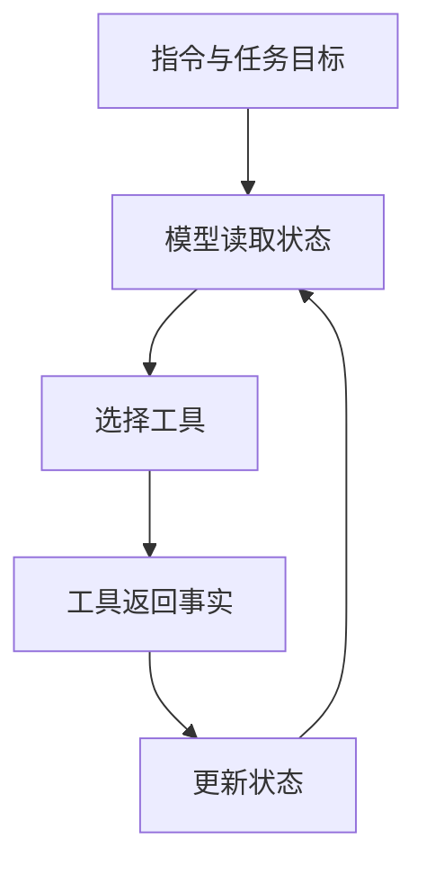

# 134. Agent 四个核心部件：模型、指令、工具、状态

> **场景引入**：退款咨询 Agent 能回答规则，却在重启后不知道上一笔订单是否已提交。模型、指令和工具之外，还需要可信任务状态。

> 对应[原始材料](../origanl/134-别纠结框架！AI%20Agent四大核心.md)。

---

## 🎯 一句话定位

模型选下一步，指令定目标，工具接外部系统，状态保存进度；运行层再负责权限与恢复。

## 💎 核心要点概览

| 部件 | 作用 | 常见缺失 |
| --- | --- | --- |
| 模型 | 生成下一步建议 | 决策质量不稳 |
| 指令 | 说明目标和边界 | 约束不清 |
| 工具 | 获取事实或执行动作 | 权限与超时问题 |
| 状态 | 保存对象和进度 | 重启后重复执行 |

## 🚀 核心总结

> 先设计四个部件的职责和数据流，再考虑框架。

---

## 一、四个部件各回答什么

模型回答“下一步可能怎么做”；指令说明目标、边界和输出要求；工具提供外部事实或动作；状态记录任务已经走到哪里。四者打通后，还需要权限、验证和恢复，才能接近生产可用。

例如退款咨询：指令要求只给有依据的建议；状态保存订单 ID 与用户确认；订单工具给实时状态；模型组织答复。若用户要求正式退款，工具端还需权限、审批和幂等。只给模型一个 `refund` 工具而没有状态与约束，容易重复提交或错误承诺。

框架只是实现手段。先用最小代码把数据流画清楚，列出每轮状态字段和错误出口；遇到复杂分支、恢复和人工接管，再考虑框架是否节省维护。模型大小也应按目标任务的质量、延迟和成本评测，而不是只看参数量。

**面试口述：**“模型做决策，指令定目标和边界，工具接外部系统，状态保留任务进度；运行层再加权限、验证和恢复。先设计数据流，再选框架。”

**自检：**Agent 重启后只恢复聊天记录，没有订单操作状态，会有什么风险？

---

## 二、落地 Checklist

- [ ] 写清模型、指令、工具与状态各自负责什么。
- [ ] 为每轮定义状态字段、停止条件和错误出口。
- [ ] 高风险工具加入服务端鉴权、幂等和执行结果核对。

## 三、总结（一句话带走）

> **Agent 的核心是清楚的决策、动作和状态闭环。**
