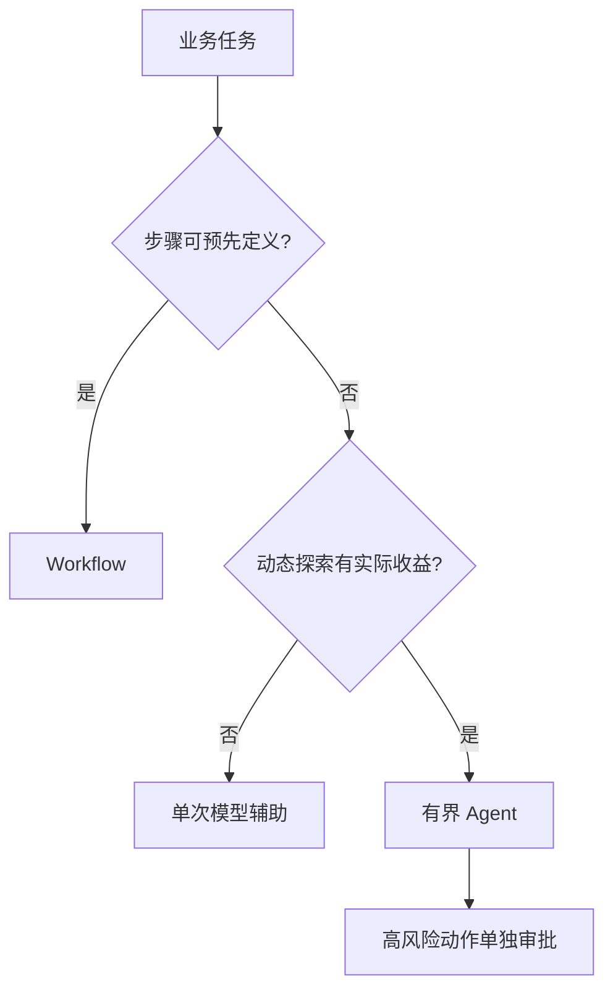

# 135. 哪些业务值得使用 Agent

> **场景引入**：发票字段固定、校验规则明确，合作企业调研却要根据新线索继续查资料。两种任务不必用同样的执行方式。

> 对应[原始材料](../origanl/135-别盲目跟风！到底什么业务适合上Agent.md)。

---

## 🎯 一句话定位

看执行路径的不确定性和错误代价，再决定用 Workflow、单次模型辅助还是有界 Agent。

## 💎 核心要点概览

| 任务特点 | 优先方案 | 理由 |
| --- | --- | --- |
| 步骤固定、规则明确 | Workflow | 易测试与审计 |
| 单次开放式判断 | 模型辅助 | 无需自主循环 |
| 路径随新信息变化 | 有界 Agent | 可动态探索 |

## 🚀 核心总结

> Agent 值得用在动态探索有实际收益且风险可控的任务上。

---

## 一、两个核心维度

一是执行路径是否随新信息变化；二是错误动作的代价是否可控。路径确定、规则清楚时，Workflow 更易测试和审计。路径开放、需要边查边决定时，Agent 才可能创造价值；若风险高，还需把关键动作收回确定性系统或人工。

发票录入适合“OCR 提取→代码校验→人工处理异常→入库”，不必让 Agent 自由规划每一步。合作企业调研的资料路径不确定，Agent 可以决定下一步查哪类公开资料，但结论仍要列出处，且不能自动签约。

选型时先做固定方案基线，再比较 Agent 的任务完成率、人工时间、尾延迟、成本与错误操作。原稿说“只要任务路径不确定就适合 Agent”也过于宽泛：若没有可信工具或完成标准，动态自主性难以带来可控收益。

**面试口述：**“我看路径不确定性和错误代价。固定任务先 Workflow，开放式探索试 Agent；关键写操作由业务服务验证。用基线实验决定是否值得增加复杂度。”

**自检：**发票字段已固定且法规要求严格，为什么不让 Agent 自主发明录入步骤？

---

## 二、落地 Checklist

- [ ] 建立固定流程基线，明确 Agent 预期解决的瓶颈。
- [ ] 列出错误动作代价、可信工具和完成标准。
- [ ] 比较完成率、人工时间、尾延迟、成本与错误操作。

## 三、总结（一句话带走）

> **让任务特点和评测结果决定方案，而不是让“Agent”名称决定。**
