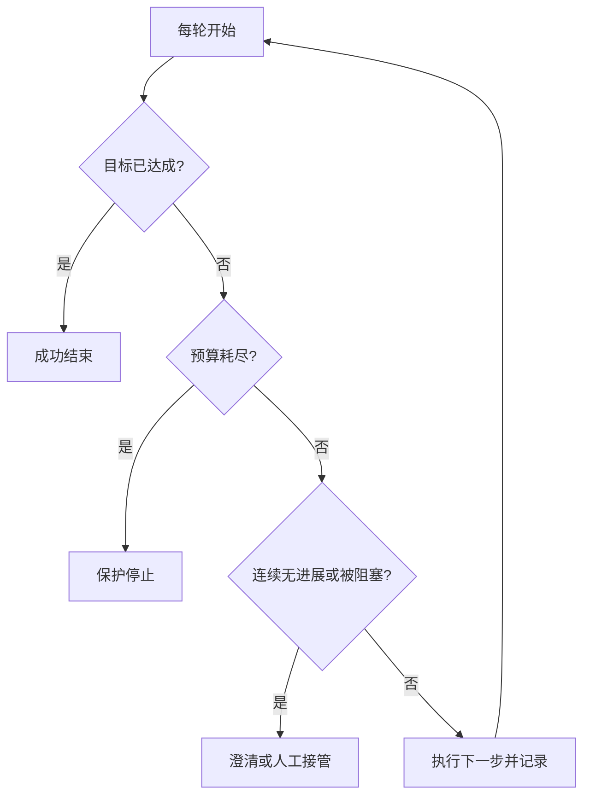

# 136. Agent Loop 的三种停止条件

> **场景引入**：订单工具连续三次返回无权限，Agent 仍不断重试。运行层需要识别“没有进展”，及时停止并说明原因。

> 对应[原始材料](../origanl/136-开发智能体不加这三道刹车，当心破产！.md)。

---

## 🎯 一句话定位

Agent Loop 需要成功、预算和阻塞三类停止条件，并由运行层强制执行。

## 💎 核心要点概览

| 停止类型 | 触发依据 | 后续处理 |
| --- | --- | --- |
| 成功 | 外部证据证明目标达成 | 交付结果 |
| 保护 | 步数、时间、费用耗尽 | 报告进度 |
| 阻塞 | 无权限、无进展或依赖缺失 | 澄清或人工接管 |

## 🚀 核心总结

> 停止条件必须有程序可检查的触发点，不能只让模型自行判断。

---

## 一、三道“刹车”

**成功停止**：业务目标有外部证据证明已完成。**保护停止**：步数、时间、token 或费用达到上限。**阻塞停止**：权限不足、依赖缺失、重复调用无进展，需要用户或人工介入。三者都应由运行层实施，不能只请模型“自行判断”。

例如查询订单时连续三次同参数调用且都返回权限拒绝，继续尝试只会烧费；应停止并要求正确授权。若工具暂时超时，可在预算内退避重试。金额写入等副作用即使预算未耗尽，也不能反复执行，需幂等键与真实状态查询。

保护预算应按任务类型配置，复杂任务可能需要更多步骤，但总有上限。停止后要报告已完成、未完成和不确定的部分，避免给用户造成“全成或全败”的错觉。

**面试口述：**“我定义目标证据、资源预算和阻塞条件，三类停止都在 Harness 执行。失败要分类，写操作先查状态，停止时如实报告进度。”

**自检：**模型一直重复查询已被拒绝的资源，属于哪种停止条件？

---

## 二、落地 Checklist

- [ ] 按任务定义成功证据和资源预算。
- [ ] 识别重复调用、权限拒绝与无进展循环。
- [ ] 停止时区分已完成、未完成和不确定部分。

## 三、总结（一句话带走）

> **有明确停止条件，Agent 才能可控地工作和失败。**
