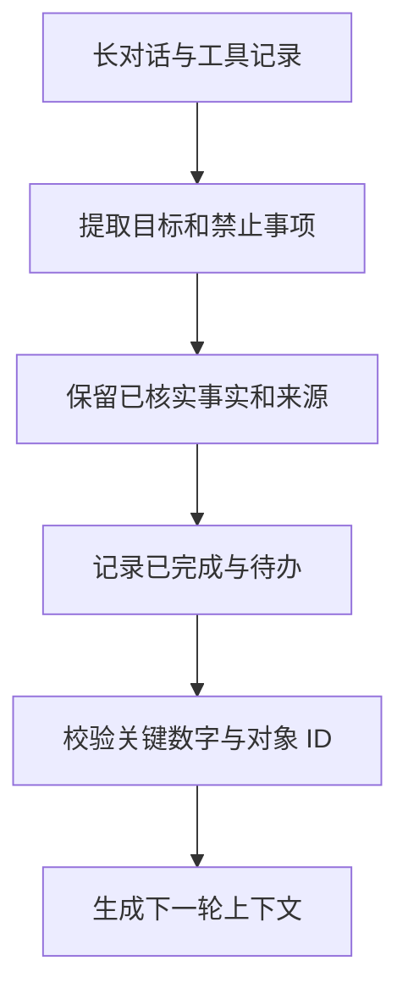

# 137. 上下文压缩要保存可执行状态

> **场景引入**：摘要只写“用户希望退款”，却丢了订单号和是否已提交。下一轮若按这份摘要继续，可能退款错单或重复退款。

> 对应[原始材料](../origanl/137-做Agent，千万别把上下文当会议纪要.md)。

---

## 🎯 一句话定位

上下文压缩要保存后续决策所需的目标、事实、标识、进度和约束。

## 💎 核心要点概览

| 信息 | 处理方式 | 原因 |
| --- | --- | --- |
| 订单 ID、金额、否定条件 | 原样保留 | 错一位就可能错单 |
| 已核实事实与来源 | 分字段标记 | 避免把猜测当事实 |
| 长篇解释 | 可压缩 | 不影响后续执行 |

## 🚀 核心总结

> 压缩是任务存档，不是写一份读起来顺畅的会议纪要。

---

## 一、会议纪要为什么不够

“我们讨论了退款事宜，用户希望尽快处理”读起来通顺，却丢了订单号、退款金额、用户是否确认、工具调用是否成功。下一轮 Agent 若据此继续执行，可能重复退款或操作错订单。压缩的目标是保留**后续决策所需的事实与进度**。

## 二、一份可执行摘要

字段可以是 `goal`、`order_id`、`confirmed_amount`、`approved_by`、`tool_status`、`pending_step`、`constraints`、`source_refs`。订单 ID、金额、时间、否定条件和文件路径要原样保留；自然语言解释可压缩。外部业务状态不能仅凭摘要推断，恢复时要查询订单系统。

将模型的推测与工具返回的事实分开标注。摘要生成后做 schema 校验和关键字段对照，丢字段就拒绝替换原历史。对于重要任务，可同时保留原始记录引用供按需回看。

**面试口述：**“上下文压缩是任务存档，保目标、事实来源、进度、约束和精确标识；叙述可概括，关键数字不能意译。恢复前对照真实业务状态。”

**自检：**摘要只写“退款已处理”，却没有业务流水号，能安全继续吗？

---

## 三、落地 Checklist

- [ ] 定义目标、对象 ID、金额、审批、工具状态和待办字段。
- [ ] 摘要替换历史前校验 schema 和关键字段一致性。
- [ ] 恢复任务时向业务系统核对真实状态。

## 四、总结（一句话带走）

> **可执行摘要要能支持安全的下一步，而不只是复述过去。**
