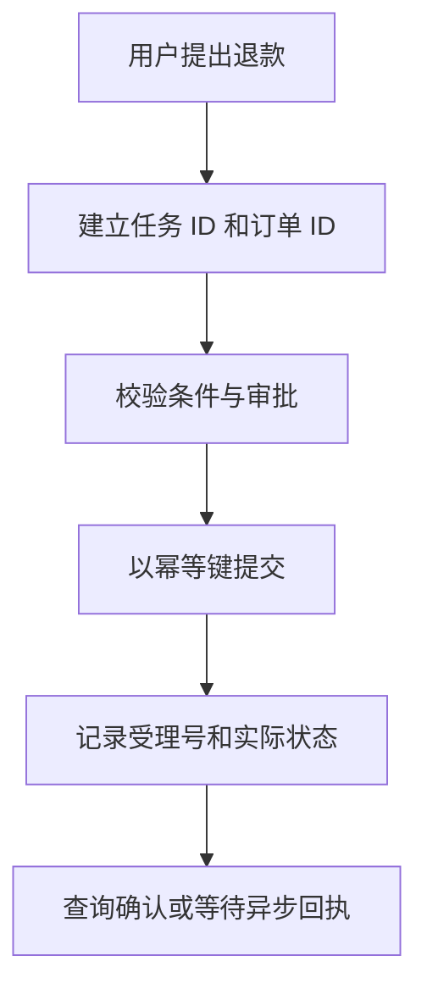

# 138. 退款任务状态不能从聊天记录猜

> **场景引入**：客服回复“已为您处理”，支付系统却没有流水号。文字不能证明退款已提交，必须查真实业务状态。

> 对应[原始材料](../origanl/138-AI退款翻车真相：聊天记录不是任务状态.md)。

---

## 🎯 一句话定位

聊天记录表达用户意图，任务状态与支付流水决定退款是否真实发生。

## 💎 核心要点概览

| 信息 | 来源 | 用途 |
| --- | --- | --- |
| 用户意图 | 对话 | 确认需求 |
| 任务进度 | 任务表 | 恢复与防重复 |
| 退款结果 | 支付流水 | 最终事实 |

## 🚀 核心总结

> 资金动作的成功与否以业务系统为准，接口超时应先查状态。

---

## 一、关键区别

“正在为您退款”是对话文本，不是支付系统的状态。退款是否已提交、是否到账，应以业务记录和支付流水为准。聊天记录用于理解用户意图；任务状态用于控制执行、恢复和防重复。

状态机至少区分草稿、待确认、处理中、成功、失败和状态未知。接口超时时不能直接标为失败：请求可能已经成功，先按幂等键查支付系统。服务器重启后从任务表恢复，而非把旧聊天发给模型让它猜“执行到哪了”。

如果用户重复说“再退一次”，系统应查询同一业务请求是否已受理，必要时要求明确的新授权。外部退款若异步处理，只能报告受理号和当前状态，不应承诺到账时间。

**面试口述：**“聊天保存语义，任务表保存真实状态和业务流水。退款用状态机、幂等键与下游对账；重启或超时后先查实际结果，不让模型根据话术重试资金动作。”

**自检：**客服说‘已为您处理’，支付流水缺失，这笔退款处于什么状态？

---

## 二、落地 Checklist

- [ ] 记录任务 ID、订单 ID、幂等键与支付受理号。
- [ ] 状态机区分处理中、成功、失败和状态未知。
- [ ] 超时或重启后查询下游真实状态，再决定是否继续。

## 三、总结（一句话带走）

> **别从聊天话术推断退款结果，要从任务表和支付流水确认。**
