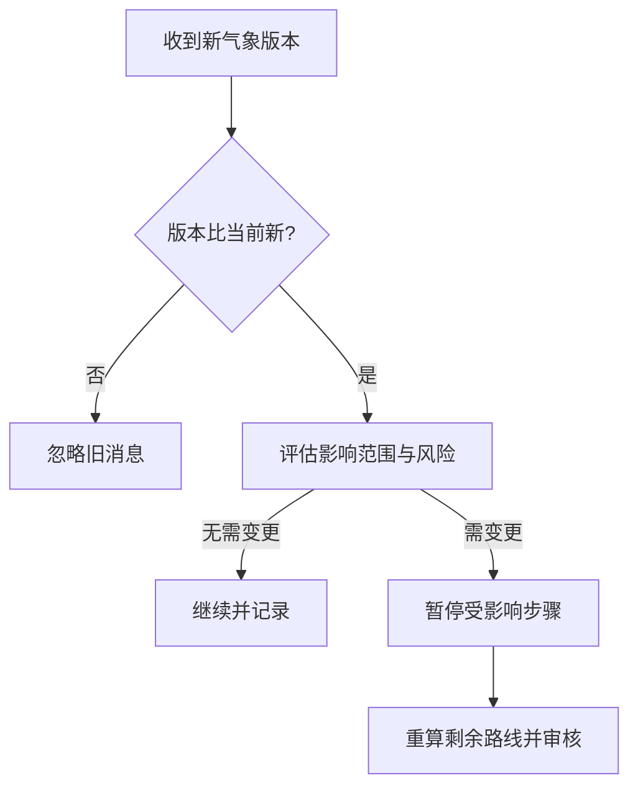

# 139. 台风更新后：计划何时失效、何时重算

> **场景引入**：配送路线按气象版本 108 制定，版本 107 的延迟消息随后到达。旧数据不能覆盖新计划，受影响的未执行路段才需要重算。

> 对应[原始材料](../origanl/139-Agent遇到台风该重算路线吗.md)。配送安全涉及实际运营，具体阈值由业务和专业系统定义。

---

## 🎯 一句话定位

计划是带输入版本和执行进度的快照；新消息要先验版本与影响，再决定是否重规划。

## 💎 核心要点概览

| 判断 | 处理 |
| --- | --- |
| 消息版本旧 | 忽略，防止回退 |
| 新信息不影响路线 | 保持计划并记录 |
| 安全或可行性受影响 | 暂停相关步骤，重算剩余部分 |

## 🚀 核心总结

> 重规划只针对被新事实影响且尚未执行的部分，安全阈值由专业规则控制。

---

## 一、先把计划当快照

路线基于某版天气、地图、道路和车辆信息生成。台风数据更新不代表每次都要立刻重算全部任务，但必须检查新信息是否影响路线安全和可行性。计划保存输入版本、生成时间、有效期与已执行进度。

消息可能乱序：版本 108 已处理后，迟到的 107 不应覆盖它。已完成配送不能“回滚”；重规划只针对剩余部分。若模型不可用或信息不足，应按既有应急流程暂停、人工调度或使用经过验证的规则，不要凭模型猜安全路线。

把重算触发条件写成可检查规则，如官方预警级别、道路封闭、预计延误和已执行状态，而不是让模型凭一句“天气变差”决定。验证包括计划版本、执行确认和异常告警。

**面试口述：**“路线是带输入版本的快照。新消息先做版本与影响判断，只对未执行部分重规划；安全阈值由业务规则控制，模型给建议，调度系统审核执行。”

**自检：**气象版本 108 已生效，延迟到达的 107 能覆盖路线吗？

---

## 二、落地 Checklist

- [ ] 保存计划输入版本、生成时间、有效期和执行进度。
- [ ] 对乱序消息先做版本检查，再做影响范围判断。
- [ ] 高风险变化按业务阈值暂停并交由调度审核。

## 三、总结（一句话带走）

> **版本先行、影响再判、只重算未执行部分。**
