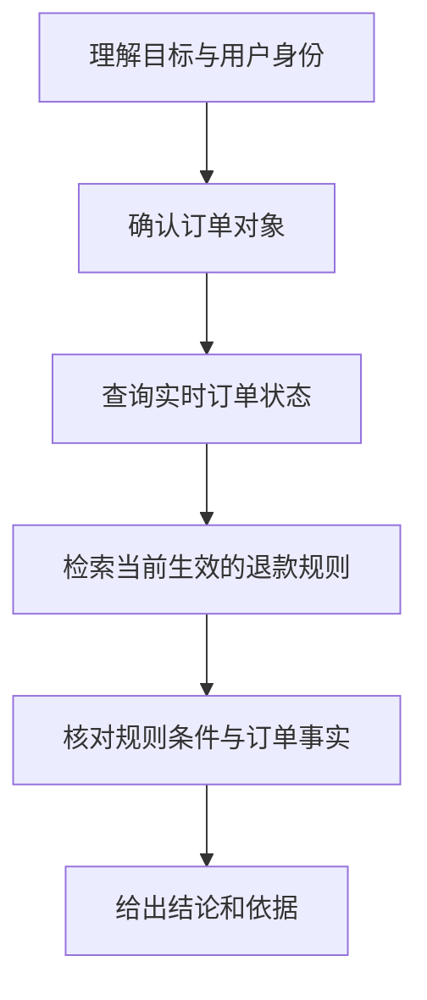

# 14. Agent 入门怎么学？从零搭起知识框架

> **场景引入**：用户问“为什么我的订单还不能退款”。模型需要同时查实时订单和当前规则；只背“规划、记忆、工具”无法处理接口超时或制度冲突。

> 对应原稿：[14-Agent入门怎么学？从零搭起知识框架-20261021](../origanl/14-Agent入门怎么学？从零搭起知识框架-20261021.md)。这篇原稿包含课程推广，但也提出了“别只背名词，要讲清完整执行链路”的学习问题；本文聚焦这条链路。

---

## 🎯 一句话定位

**理解 Agent，要能讲清它怎样从目标走到结果，以及每一步失败时怎么处理。** “规划、记忆、工具、反思”只是标签，无法替代对状态流转、数据来源和安全边界的理解。

---

## 💎 核心要点概览

| 环节 | 要问自己的问题 |
| --- | --- |
| 目标 | 用户究竟要知道什么、完成什么 |
| 数据 | 哪些来自实时工具，哪些来自制度文档 |
| 决策 | 当前条件是否足够，是否需要澄清 |
| 执行 | 工具有无权限、超时后怎样查状态 |
| 验证 | 结论和引用是否支持最终回答 |

---

## 🚀 核心总结

> **把抽象组件放回具体任务链，才看得出它们各自解决什么问题。**

---

## 一、一条最小执行链

用户说：“帮我查订单，并解释为什么还不能退款。”一个可靠的处理过程是：

其中查询订单是工具调用，读取规则是检索，记住当前讨论的是哪笔订单属于会话状态。若用户没给订单号，应先澄清或从已授权的当前会话中确定对象。若查询失败，不应让模型猜订单状态。若检索到两版规则，应核对生效时间。**能把这些异常讲明白，才算懂执行链路。**

## 二、把知识按“问题—能力”整理

| 遇到的问题 | 需要掌握的能力 |
| --- | --- |
| 模型不知道私有、经常更新的规则 | 文档解析、RAG、版本与引用 |
| 模型不知道实时订单状态 | 工具调用、权限、超时处理 |
| 用户连续几轮省略对象 | 会话状态与任务状态 |
| 工具执行一半失败或用户取消 | 重试、幂等、补偿、可观测性 |
| 能跑但不知道质量如何 | 评测集、错误归因、回归测试 |

学习时每掌握一项能力，就把它加进同一个小项目，并留一条能复现的失败案例。先回答“为什么需要它”，再学习“用什么框架实现”。

## 三、一套自检方法

关掉教程，试着白板讲解：任务输入是什么；哪些信息来自用户、知识库、业务工具；哪些决定由模型作，哪些由程序控制；输出如何验证；失败后状态如何恢复。如果只能讲框架 API，讲不清这些问题，就回到最小案例补链路。

原稿关于市场机会、学习效率倍数、课程服务与退款的说法属于推广内容，不能作为技术能力或职业结果的证据。选择学习资料时，优先检查是否有完整案例、可运行代码、失败处理和评测方法。

## 四、面试口述版

> 我把 Agent 看成一条有状态的目标执行链：理解目标，按需要检索知识或调用工具，拿到结果后决定下一步，最后校验并交付。对工具超时、知识冲突、用户取消等情况要定义状态和恢复方式。框架只是实现手段，我会先说明每个环节为什么存在，再谈具体技术选型。

**自测：**如果订单接口超时，Agent 能否继续给退款结论？如果检索到两份不同年份的政策，下一步应查什么？

**一句话带走：会背概念是入门，能解释执行链与失败处理才是掌握。**

---

## 五、实践 Checklist

- [ ] 能明确目标、订单对象、用户身份和当前政策版本。
- [ ] 实时事实来自业务工具，不从旧对话或静态文档猜测。
- [ ] 接口超时和资料冲突时有暂停、补查或澄清路径。
- [ ] 最终回答区分已证实事实与仍待确认的信息。

## 六、总结（一句话带走）

> **先讲完整任务如何闭环，再谈用了哪些 Agent 名词或框架。**
