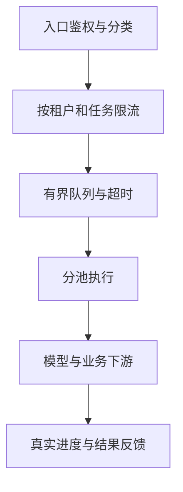

# 140. 十万请求涌入：Agent 服务如何做容量设计

> **场景引入**：入口每秒接收 100 个任务，每任务平均调用模型 4 次，而模型限额只有每秒 100 次。只加网关机器会更快压垮下游。

> 对应[原始材料](../origanl/140-Agent如何扛住十万高并发.md)。数字“十万”需先明确是同时连接、瞬时请求还是每秒到达量。

---

## 🎯 一句话定位

Agent 容量要按每任务的模型和工具调用量计算，并受下游配额约束。

## 💎 核心要点概览

| 环节 | 要算什么 | 常见措施 |
| --- | --- | --- |
| 入口 | 到达率与任务类型 | 鉴权、限流 |
| 执行 | 平均步骤与排队时长 | 有界队列、分池 |
| 下游 | 模型与工具配额 | 并发控制、降级 |

## 🚀 核心总结

> 吞吐由最紧的下游瓶颈决定，队列只能削峰，不能创造容量。

---

## 一、从容量模型开始

一个 Agent 请求可能多次调用模型和工具。按任务类型估计峰值到达率、平均步骤、每步耗时与 token；算出模型配额、数据库连接和外部 API 负载。直接增加网关机器，可能只会让下游更快过载。

只读高频问题可在权限与时效范围内缓存；写操作必须遵守事务、幂等和对象级并发控制。队列削峰但不创造算力，排队超时要及时拒绝或转异步。不同优先级任务可以用不同执行池，避免大报告挤占订单查询。

监控入口拒绝率、队列长度、模型每秒调用、工具 P95/P99、任务完成率和单位成功任务成本。降级时保持业务正确性：低风险问答可简化，资金动作不能省去权限与审批。

**面试口述：**“先定义十万的流量含义，按 Agent 平均模型和工具调用数建立容量模型；入口限流、有界队列、分池执行，按下游配额控制。以尾延迟、完成率和成本验证。”

**自检：**每任务平均 4 次模型调用，模型限额每秒 100 次，入口每秒接 100 个任务会怎样？

---

## 二、落地 Checklist

- [ ] 明确“十万”是并发连接、瞬时请求还是每秒请求。
- [ ] 按任务估计调用数、token、下游连接和峰值负载。
- [ ] 监控队列、拒绝率、P95/P99、完成率和单位任务成本。

## 三、总结（一句话带走）

> **先算下游容量，再做限流、排队和分池执行。**
