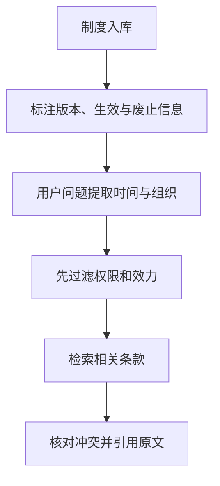

# 141. 新旧制度同时召回：先看效力元数据

> **场景引入**：今天上传的新差旅制度下月才生效，员工却问今天的报销。按上传时间选“最新”会给出错误规则。

> 对应[原始材料](../origanl/141-Agent如何判断新旧制度生效.md)。具体制度效力是法律或组织治理问题，系统应依据权威来源与业务规则，不能让模型自行裁决。

---

## 🎯 一句话定位

制度检索先按业务时间、组织和效力元数据过滤，再比较语义相关性。

## 💎 核心要点概览

| 字段 | 作用 |
| --- | --- |
| 发布与生效日 | 区分公布和执行 |
| 废止与替代关系 | 排除失效版本 |
| 适用组织与时间 | 匹配当前问题 |

## 🚀 核心总结

> 文本相关不等于规则有效，版本判断须有权威元数据。

---

## 一、结论

语义相似度只表示“文字相关”，不表示“这份制度现行有效”。知识库要保存发布、生效、废止、适用组织与替代关系；查询时先按用户、时间和场景过滤，再让模型解释规则。

上传时间不是生效时间。今天上传的可能是下个月才执行的试行稿；旧制度也可能对历史订单仍适用。每个片段保留文档 ID、页码、条款和版本，不要把不同版本片段混成一段答案。若补充通知与主制度关系不清，标为待核实并交给制度负责人。

**面试口述：**“先治理文档元数据，按问题发生时间、组织和权限筛选有效版本，再检索条款。遇到替代或补充关系不明时不猜测，返回冲突证据并转人工确认。”

**自检：**今天上传、下月生效的制度能用于今天的报销吗？

---

## 二、落地 Checklist

- [ ] 入库记录发布、生效、废止、组织和替代关系。
- [ ] 查询时先确定事件时间与适用主体。
- [ ] 冲突或效力不明时列出证据并交制度负责人。

## 三、总结（一句话带走）

> **先判哪份制度适用，再让模型解释条款。**
