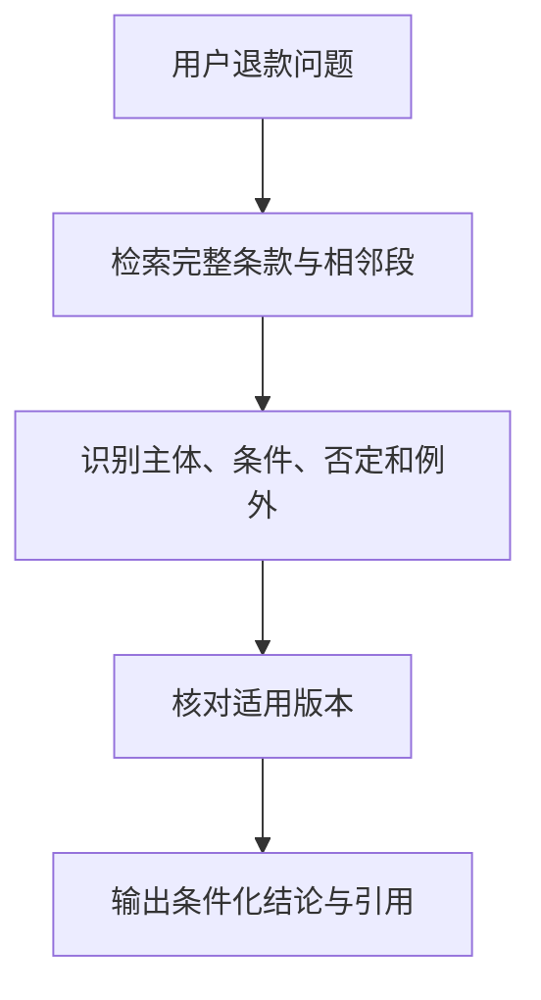

# 142. RAG 遇到“不得退款”：先划清否定范围

> **场景引入**：检索只返回“不得退款”，漏掉下一句“质量问题除外”。若直接回答“不能退”，就把条件结论说成绝对结论。

> 对应[原始材料](../origanl/142-RAG遇到否定条款怎么防坑.md)。合同判断需结合完整文本与适用规则，本文说明检索系统的技术设计。

---

## 🎯 一句话定位

否定条款必须连同主体、条件、例外和时间一起检索与解释。

## 💎 核心要点概览

| 要素 | 核对问题 |
| --- | --- |
| 否定对象 | 禁止的到底是哪种行为？ |
| 适用条件 | 哪些商品、用户或时间？ |
| 例外条款 | 有无“除外”“但书”？ |

## 🚀 核心总结

> 分块和回答都要保留否定句的完整逻辑范围。

---

## 一、四个必须一起看

“不得退款”可能只针对特定商品、某个时间段或未满足条件的用户；后文可能写“质量问题除外”。回答前要识别**否定对象、适用主体、条件与例外、有效时间**。只命中“退款”关键词，或只抽出一句话，都可能把结论答反。

入库时以条款边界切块，把标题、主句、例外和附件引用连在一起；长条款可以拆分，但保留父条款 ID。检索结合关键词和语义召回，并检查证据是否覆盖全部问题条件。模型输出应采用“在 X 条件下，不得 Y；若 Z 则例外”的结构，而不是只给“可退/不可退”。

**面试口述：**“否定条款要保留修饰范围和例外，先做结构化分块、版本过滤，再核对证据完整性。无法确定适用条件时拒绝二元结论。”

**自检：**只召回‘不得退款’，没召回下一句‘质量问题除外’，可以直接答用户吗？

---

## 二、落地 Checklist

- [ ] 按条款边界切块并保留相邻句与附件引用。
- [ ] 校验主体、条件、例外和有效版本是否齐全。
- [ ] 缺关键事实时给条件化答案或要求补充。

## 三、总结（一句话带走）

> **先看“不得”限制了谁和什么，再判断具体问题。**
