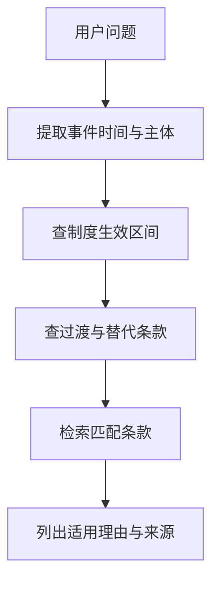

# 143. 制度版本判断：从查询条件反推适用范围

> **场景引入**：员工问去年 12 月的出差费用，系统却只检索今天的制度。历史事项可能适用历史版本。

> 对应[原始材料](../origanl/143-Agent如何判断生效制度.md)。与第 141 篇同题，这里重点说明“查询时间”不一定是今天。

---

## 🎯 一句话定位

从业务事件的时间和主体反推适用制度，不默认“最新制度”适用所有问题。

## 💎 核心要点概览

| 时间 | 要问什么 |
| --- | --- |
| 事件日 | 费用何时发生？ |
| 提交日 | 申请何时提出？ |
| 生效日 | 规则何时开始执行？ |

## 🚀 核心总结

> 哪个日期决定效力，应由制度或业务规则明确。

---

## 一、先确认用户问的是什么时候

用户问“去年 12 月出差能报多少”，即使今天已有新制度，也可能应按去年出差时的适用规则判断。要提取事件发生日、报销提交日、所在组织和费用类别；究竟哪个日期决定效力，应由制度本身或业务规则明确。

文档元数据至少包含发布日、生效日、废止日、适用组织、版本和替代关系。查询前按这些字段筛选；补充通知或过渡期不能仅凭“最新文件”覆盖主制度。若缺少关键日期，先向用户澄清。若同一时间两个文件都自称有效，列出冲突并交制度负责人，不让模型私自选一个。

**面试口述：**“版本判断先解析问题的业务时间与主体，再用元数据过滤，最后核对过渡和替代关系。历史业务不一定适用今天的最新版。”

**自检：**用户问去年发生的费用，系统只按今天生效制度检索，会有什么风险？

---

## 二、落地 Checklist

- [ ] 提取事件时间、提交时间、组织和费用类别。
- [ ] 按制度元数据过滤并检查过渡条款。
- [ ] 缺日期先澄清，冲突版本交权威负责人判断。

## 三、总结（一句话带走）

> **先确定问题发生在哪个业务时间，再找对应制度。**
