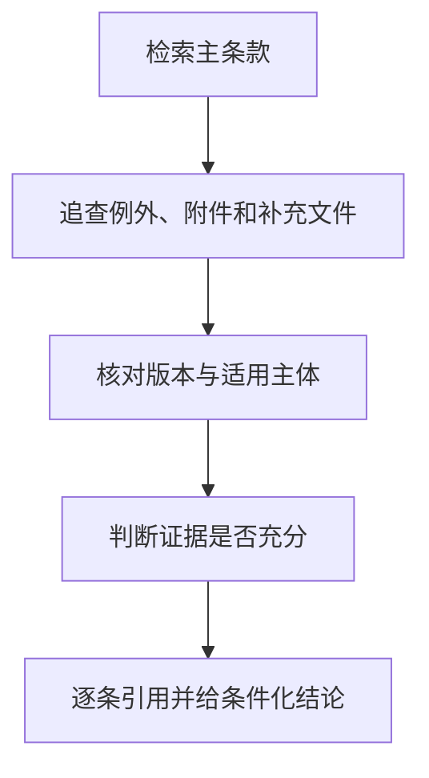

# 144. 否定条款的证据链：主句与例外都要引用

> **场景引入**：主合同说“不得退款”，附件却规定未开通服务的订单七日内可退。只引主合同会给出片面结论。

> 对应[原始材料](../origanl/144-RAG如何处理否定条款？.md)。

---

## 🎯 一句话定位

回答否定条款要同时找主规则、例外、附件和业务事实，形成完整证据链。

## 💎 核心要点概览

| 证据 | 作用 |
| --- | --- |
| 主句 | 给出默认规则 |
| 例外与补充文件 | 改变适用范围 |
| 订单状态 | 判断个案是否满足条件 |

## 🚀 核心总结

> 找到最相似片段只是开始，证据必须覆盖结论所需条件。

---

## 一、结论

回答合同或制度中的“能否退款”，引用一条主句不够。若存在附件、例外或补充协议，答案必须能说明它们如何改变主规则。检索目标是**完整证据链**，不是仅找到最相似的片段。

例如主合同说“不得退款”，附件说“未开通服务的订单可在 7 日内退款”。用户提供的订单是否开通、是否在 7 日内都要从业务系统取得。检索系统应保存条款层级和交叉引用，避免分块把附件链接丢掉。若缺订单状态，回答应说明现有资料只能确认规则，不能判定这笔订单。

排障时保存各阶段证据：原文、分块、召回、重排、最终回答。先找第一个丢失例外的环节，而不是只改最终提示词。

**面试口述：**“我把否定主句、例外和补充文件视为一条证据链，分块和索引保留引用关系。输出列条件、来源和缺失事实，不用单段文本直接下结论。”

**自检：**引用主合同禁止退款，却不查用户提到的补充协议，答案完整吗？

---

## 二、落地 Checklist

- [ ] 索引保存条款层级与附件、补充协议引用。
- [ ] 同时核对主句、例外、版本和个案业务状态。
- [ ] 排障时追踪例外在解析、召回、重排哪一步丢失。

## 三、总结（一句话带走）

> **主句与例外要一起引用，才能解释个案结论。**
