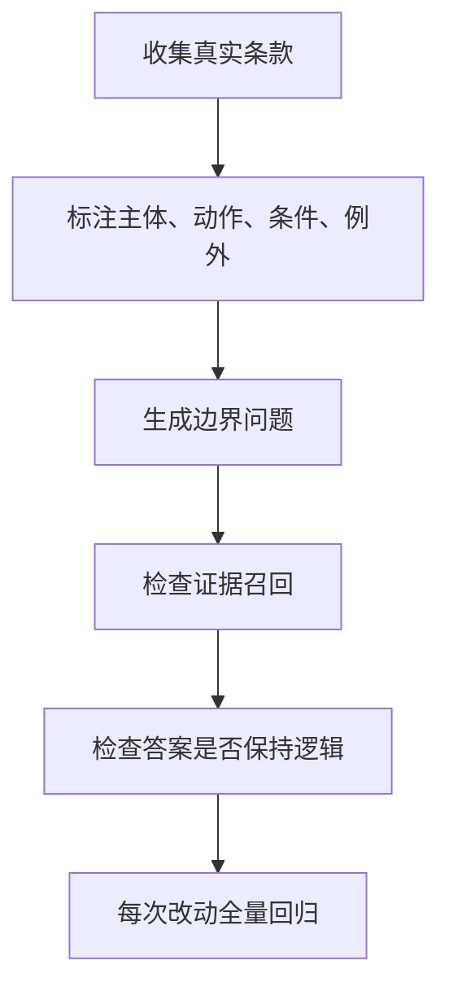

# 145. 否定条款如何评测：专测边界与反例

> **场景引入**：系统总准确率 95%，却经常把“质量问题除外”答反。上线前必须单独测这些高风险边界。

> 对应[原始材料](../origanl/145-RAG如何精准处理否定条款.md)。与第 142、144 篇同主题，这里侧重评测和上线回归。

---

## 🎯 一句话定位

否定条款评测要专测范围、例外、时间与缺信息场景，不能只看总体准确率。

## 💎 核心要点概览

| 样例类型 | 应检验什么 |
| --- | --- |
| “除外”“仅限于” | 逻辑范围是否正确 |
| 时间和附件边界 | 版本与优先级是否正确 |
| 缺少事实 | 是否拒绝武断结论 |

## 🚀 核心总结

> 按错误代价建立专项回归集，分别测证据召回和答案逻辑。

---

## 一、为什么普通准确率不够

若测试集里大多是“是否可以退款”的简单肯定句，系统即使经常误读“除外”“仅限于”，总准确率仍可能很好看。应专门构造否定范围、双重否定、例外、时间边界、附件优先级和缺信息问题，测系统是否在该拒答时拒答。

每个样例标注正确结论、必须引用的段落和缺失的外部事实。例如“质量问题除外”需要质量状态，没提供时正确行为可能是“暂无法判断”，而非猜测可退。将错误分为解析切断、召回遗漏、重排降权、模型误解和业务状态缺失，针对首个错误环节修复。

**面试口述：**“否定条款我会单独建边界评测集，标注主句、例外和必要事实；既测召回也测答案逻辑，缺信息时允许拒答，并用失败归因回归。”

**自检：**系统 95% 总准确，但‘除外’类问题大量答反，可以上线合同审查吗？

---

## 二、落地 Checklist

- [ ] 标注主句、例外、必要事实和正确结论。
- [ ] 错误归因到解析、召回、重排、生成或状态缺失。
- [ ] 每次改动回归边界集，统计专项错误率。

## 三、总结（一句话带走）

> **高总体分数掩盖不了否定与例外类的严重错误。**
