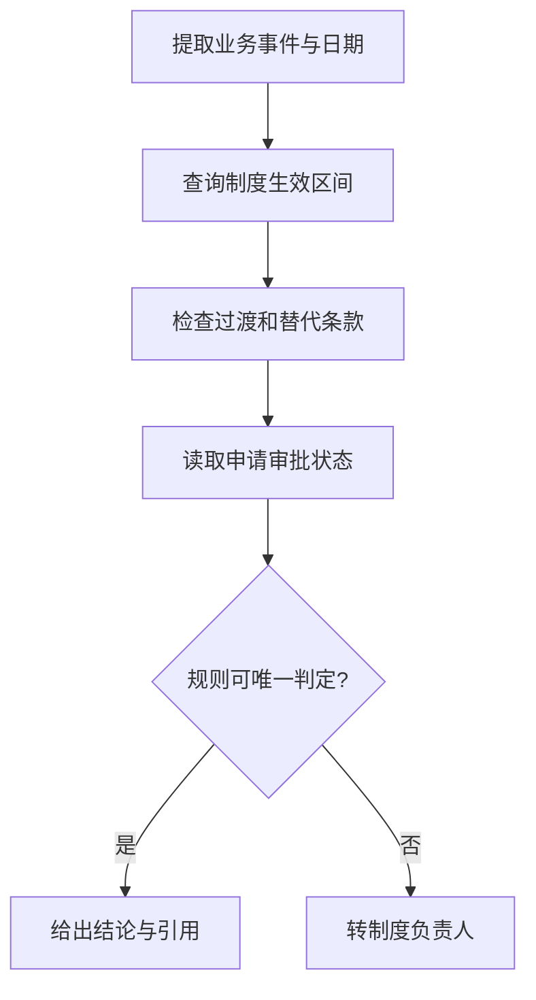

# 146. 制度过渡期：不能只按发布日期排序

> **场景引入**：新制度 10 月发布、11 月生效，还规定已审批申请继续用旧标准。只按日期排序无法判断这笔申请。

> 对应[原始材料](../origanl/146-Agent如何判断生效制度（重发）.md)。这篇与第 141、143 篇同题，重点放在过渡期与冲突兜底。

---

## 🎯 一句话定位

制度过渡期判断需要日期、审批状态和替代关系共同参与。

## 💎 核心要点概览

| 信息 | 为什么需要 |
| --- | --- |
| 生效日期 | 判定基本适用区间 |
| 过渡条款 | 决定旧申请是否沿用旧规 |
| 审批状态 | 判定个案落在哪个例外 |

## 🚀 核心总结

> 过渡规则是业务条件，不是“选最新文件”能解决的排序问题。

---

## 一、一个过渡期例子

新差旅制度 10 月 1 日发布，11 月 1 日执行；通知又规定“已审批但未出行的申请按旧标准”。那么 10 月 20 日提交、11 月 5 日出行的申请，不能仅按最新上传时间或出行日判断。系统要把过渡规则和业务状态一起取出。

入库时保存文档 ID、版本、发布时间、生效与废止日期、适用组织和被替代关系。召回后做证据充分性检查：若缺审批时间或状态，先澄清；若两个有效文件互相冲突，输出冲突位置，不让模型“选看起来更新的一份”。

**面试口述：**“生效判断是业务规则，不是向量相似度排序。先查日期和组织，再处理过渡、补充与替代关系；证据冲突或关键状态缺失就暂停结论。”

**自检：**一份新制度已发布但尚未生效，可以覆盖旧制度吗？

---

## 二、落地 Checklist

- [ ] 保存制度生效区间、替代和过渡条款。
- [ ] 读取申请发生时间及审批状态，核对例外条件。
- [ ] 信息缺失先澄清，规则冲突转制度负责人。

## 三、总结（一句话带走）

> **过渡期要把制度文本与申请状态放在一起判断。**
