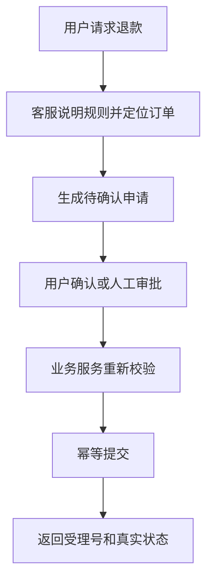

# 147. AI 客服能解释退款，执行退款还需业务控制

> **场景引入**：AI 昨天查到订单未发货，今天用户要求退款。提交前必须重新读取订单状态，不能凭昨天的回答执行资金动作。

> 对应[原始材料](../origanl/147-AI客服为何不能直接退款？.md)。

---

## 🎯 一句话定位

模型可解释政策和准备申请，退款执行必须由业务服务按最新状态、权限与审批控制。

## 💎 核心要点概览

| 阶段 | 责任 |
| --- | --- |
| 咨询 | 解释规则、定位订单 |
| 确认 | 展示金额、对象和后果 |
| 执行 | 重新校验、幂等提交、返回流水 |

## 🚀 核心总结

> 资金动作在提交瞬间重新校验，不能由聊天历史代替。

---

## 一、风险差别

解释退款政策是信息输出；退款会改变订单与资金状态。模型可协助理解用户诉求、收集材料，但不能凭聊天记录或旧查询结果决定最终退款金额。业务服务必须在提交瞬间重新检查订单状态、用户权限与金额规则。

网页端与 AI 可能同时发起退款，后端要用状态条件更新、唯一约束或事务确保只受理一次。接口超时可能已成功，重试前先查业务流水；异步退款只表示已受理，不应承诺到账。审批应绑定订单、金额与收款账户，参数变化要重新确认。

**面试口述：**“模型负责沟通与准备申请，资金动作由订单/支付服务按最新状态、权限和审批执行。并发用状态机和幂等控制，超时先对账，回复只报真实处理状态。”

**自检：**AI 看到昨天的订单状态为未发货，就能直接在今天退款吗？

---

## 二、落地 Checklist

- [ ] 退款前重新检查订单、权限、金额和审批参数。
- [ ] 并发请求使用幂等键和状态条件更新。
- [ ] 超时先查流水，异步处理中只报告真实受理状态。

## 三、总结（一句话带走）

> **AI 负责沟通，业务系统负责资金状态。**
