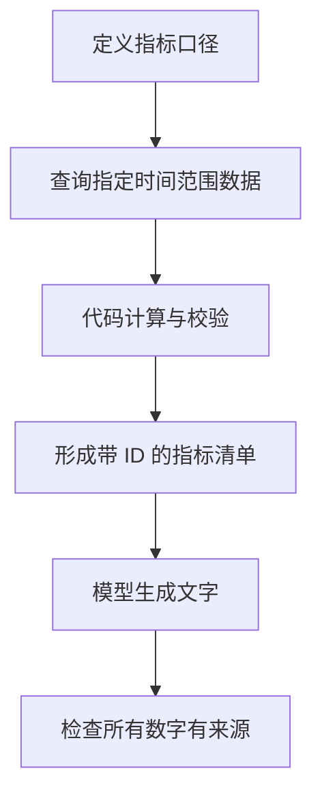

# 148. AI 周报数字：代码算，模型写

> **场景引入**：模型写出“本周增长 20%”，但指标包里没有环比数据。发布前应拦截这句无来源数字。

> 对应[原始材料](../origanl/148-AI写周报总编数字怎么办？.md)。

---

## 🎯 一句话定位

由数据服务定义口径并计算指标，模型负责叙述，输出数字逐一核验来源。

## 💎 核心要点概览

| 工作 | 负责方 | 验收 |
| --- | --- | --- |
| 定义与计算指标 | 数据查询和代码 | 口径、单位、区间明确 |
| 组织文字 | 模型 | 引用指标 ID |
| 发布校验 | 程序与人工 | 数字均有来源 |

## 🚀 核心总结

> 数字准确靠确定性计算和校验，提示词只能辅助。

---

## 一、先把数字变成受控输入

收入、完成量、环比等指标要由数据库查询和确定性计算得到，模型只负责解释。提示词写“不要编数字”有帮助，但不是事实保证；输出需能逐一引用已计算的指标 ID。

例如“本周新增客户”必须先确定是注册数、首次付费数还是去重企业数。指标包保存名称、数值、单位、统计区间、计算口径、数据版本和异常标记。模型输出可以是“本周新增客户为 `metric_17`”，渲染层再把它替换为受控数字，进一步降低编造风险。

对同比、环比由代码计算并处理分母为零；模型不能自行补一个“增长 23%”。若数据缺失，报告写“暂无数据”并说明原因。发布前检查正文所有数字与指标包对应，允许人工复核重点段落。

**面试口述：**“数据服务定义口径并算出指标，模型只组织叙述。输出引用指标 ID，渲染或校验层检查所有数字、单位和时间范围。”

**自检：**模型写‘增长 20%’，但指标包没有环比值，应怎样处理？

---

## 二、落地 Checklist

- [ ] 为指标保存口径、单位、时间区间和数据版本。
- [ ] 同比环比由代码计算，并处理分母为零。
- [ ] 发布前检查正文所有数字均能映射到指标包。

## 三、总结（一句话带走）

> **让模型讲数据，让程序负责数据本身。**
