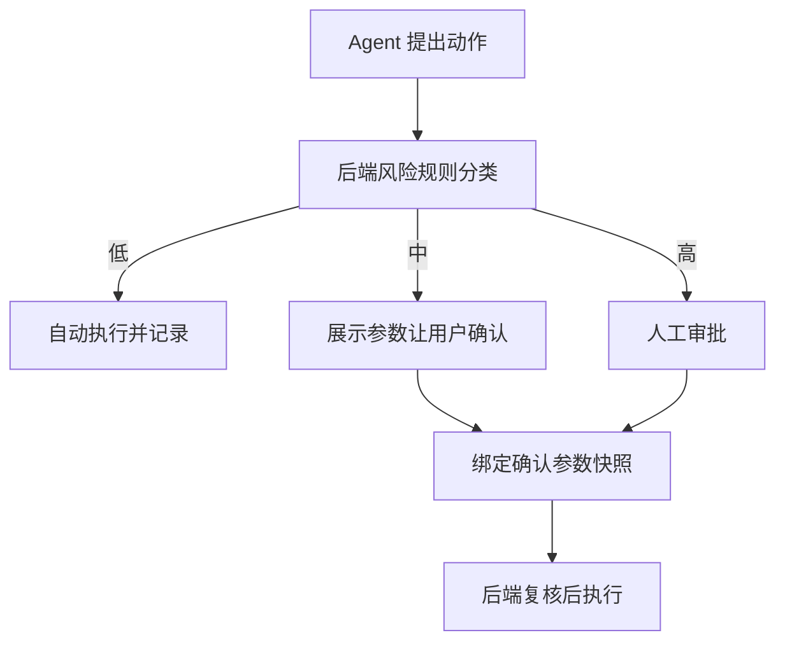

# 149. Agent 操作确认：按后果分级

> **场景引入**：查订单每次弹窗会干扰用户，转账完全不确认又风险过高。确认强度应随动作后果增加。

> 对应[原始材料](../origanl/149-Agent操作确认如何分级？.md)。

---

## 🎯 一句话定位

按可逆性、影响范围、敏感度和金额确定自动执行、预览确认或人工审批。

## 💎 核心要点概览

| 等级 | 典型动作 | 控制 |
| --- | --- | --- |
| 低 | 授权范围内只读 | 自动并留痕 |
| 中 | 可逆修改 | 展示参数确认 |
| 高 | 资金或不可逆发布 | 人工审批与复核 |

## 🚀 核心总结

> 确认规则由业务后端制定，审批必须绑定实际执行参数。

---

## 一、分级原则

每一步都弹窗会让用户疲劳；完全不确认又会让资金、数据或公开发布失控。按**可逆性、影响范围、敏感度和金额**制定规则：低风险只读可自动执行；中风险修改给预览确认；高风险或不可逆动作交人工审批。具体边界由业务定，不让模型自行下调等级。

确认界面展示目标对象、核心参数、影响范围和是否可撤销。批准记录绑定任务 ID、参数哈希、用户和有效期；执行前若金额或收件人变化，原确认失效。前端按钮只是交互，后端和业务接口仍要检查权限与当前状态。

**面试口述：**“我按操作后果分层，只读自动、可逆修改预览、高风险人工审批；审批绑定参数快照，服务端执行前再次鉴权和校验。”

**自检：**用户批准发给 A 的邮件，模型把收件人改成 B，能沿用原确认吗？

---

## 二、落地 Checklist

- [ ] 为工具动作配置风险等级及审批方式。
- [ ] 确认界面展示对象、参数、影响和可撤销性。
- [ ] 执行前复核参数哈希、用户权限和当前业务状态。

## 三、总结（一句话带走）

> **确认次数要合理，关键参数必须被确认且执行前不变。**
