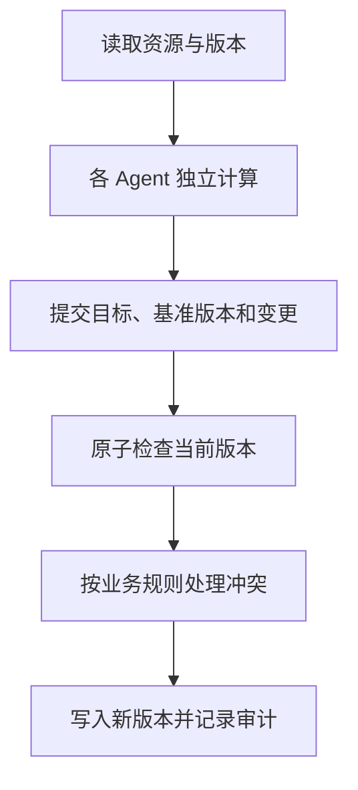

# 15. 多 Agent 并发怎么避免覆盖？版本、幂等与冲突处理

> **场景引入**：两个 Agent 都打开运营方案 v5。A 先改市场分析并保存为 v6；B 仍拿旧 v5 整篇覆盖，A 的成果就丢了。

> 对应原稿：[15-多Agent并发怎么避免覆盖？版本、幂等与冲突处理](../origanl/15-多Agent并发怎么避免覆盖？版本、幂等与冲突处理.md)。

---

## 🎯 一句话定位

**并发 Agent 可以同时思考，但共享状态的提交必须经过校验。** 先缩小共同修改的范围；提交时带上“我基于哪个版本”“我想改哪里”；系统核对版本和业务规则，再决定接受、合并、重算或交人工。

---

## 💎 核心要点概览

| 机制 | 主要挡住的错误 |
| --- | --- |
| 拆分修改范围 | 减少同一资源上的写冲突 |
| 乐观版本校验 | 阻止旧状态覆盖新状态 |
| 幂等键 | 阻止重试造成重复副作用 |
| 语义冲突处理 | 决定合并、重算、拒绝或人工裁决 |

---

## 🚀 核心总结

> **并行计算可以放开，状态提交必须带版本依据并由协调层原子验证。**

---

## 一、用多人写方案理解丢失更新

两个 Agent 都打开了运营方案 v5。A 改“市场分析”，B 改“竞品结论”。A 先提交成 v6；B 若把自己手里的整篇 v5 直接保存，就会覆盖 A 的成果。这叫**丢失更新**。

B 应提交“基于 v5，修改竞品结论”这一条变更。系统发现当前已是 v6，就检查 A 的改动是否影响 B。如果互不相干，可在新版本上合并；如果两者都改同一结论，就拒绝自动覆盖，要求重新读取或人工裁决。

## 二、四个机制分别解决什么

| 机制 | 解决的问题 | 例子 |
| --- | --- | --- |
| 资源拆分 | 减少共享写入 | 市场、竞品、用户画像分别产出草稿 |
| 版本校验 | 拦住基于旧状态的提交 | `UPDATE ... WHERE version = 5`，影响 0 行就重新处理 |
| 幂等键 | 防止同一动作重试多次生效 | 同一通知任务重试仍只发一次 |
| 状态机 | 限制非法业务动作 | 已支付订单不能再次执行扣款 |

版本校验与幂等解决的是两类不同问题：A、B 基于旧版本写同一字段，靠版本检测；同一请求因超时被重复提交，靠幂等。两者都需要，不能互相替代。

## 三、锁和消息队列为什么不够

锁可以用于**短时间提交**，比如锁住一条资源记录，核对版本并写入。但模型推理可能耗时很久，若全程持有全局锁，其他 Agent 都得等。按资源加细锁、缩短持有时间通常更合理。

消息队列能让写入按顺序处理，却不会自动让旧结果变新。B 在 v5 上算出的结论即使排队到 A 之后才执行，仍可能是陈旧结论。消费者写入时仍要检查基准版本。

## 四、冲突发生后怎么选

- **自动合并：**改动互不影响，且业务规则允许合并。
- **重新计算：**新状态改变了原先的判断依据，让 Agent 读最新版本再生成。
- **拒绝提交：**变更已不合法或重复执行会有风险。
- **人工裁决：**两个方案在业务语义上冲突，自动合并无法判断对错。

文本协作场景可以研究 OT 或 CRDT，但它们处理的是特定的数据合并问题。即使两个副本最终收敛，也不代表“审批通过”和“审批拒绝”在业务上能同时成立。资金、库存等场景应优先服从交易与业务约束。

## 五、最小落地检查

每次变更记录 `resource_id`、`base_version`、`operation_id`、变更内容和执行人。对共享状态提交做原子版本比较；对产生副作用的动作保存幂等结果；冲突时明确返回原因，而不是静默覆盖。用“两个 Agent 同时改同一字段”“同一请求重复投递”“读旧版本后排队提交”三个案例做验证。

## 六、面试口述版

> 我不会把 Agent 推理过程包在一把全局锁里。先拆分可独立执行的任务，尽量缩小共享资源。Agent 提交变更时带目标资源、基准版本和操作 ID；协调层用原子版本校验挡住旧写入，用幂等键挡住重复副作用。冲突后按业务语义决定合并、重算、拒绝或人工介入。消息队列和锁都可用，但都不能单独代替版本与业务校验。

**自测：**为什么“顺序消费队列”仍可能写入过时结果？版本号与幂等键各挡住什么错误？

**一句话带走：并发的关键不是阻止 Agent 同时工作，而是让每次提交都说明依据并接受验证。**

---

## 七、生产环境 Checklist

- [ ] 每次提交包含资源 ID、基准版本、变更内容和操作 ID。
- [ ] 版本检查与写入是原子操作。
- [ ] 重试复用同一幂等键，写操作可以追溯。
- [ ] 同一区域冲突有明确拒绝、重算或人工裁决规则。

## 八、总结（一句话带走）

> **并发本身不可怕；没有版本依据的覆盖写入才危险。**
