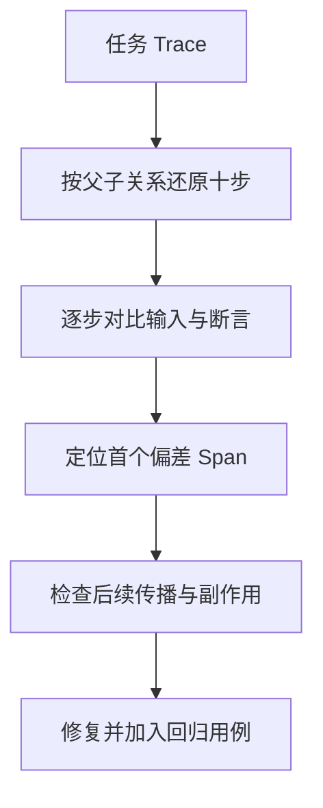

# 150. 十步工具链末尾报错：找第一个偏差点

> **场景引入**：第十步提示“找不到商品”，根因却是第三步搜索空结果被误标为成功。应沿 trace 找首个偏差。

> 对应[原始材料](../origanl/150-Agent十步调用报错如何快速定位？.md)。

---

## 🎯 一句话定位

多步 Agent 排障要按依赖链比较预期与实际，定位第一个不符合契约的输出。

## 💎 核心要点概览

| 记录 | 用途 |
| --- | --- |
| 父子 Span | 还原步骤依赖 |
| 参数与返回状态 | 找首个偏差 |
| 外部流水号 | 核对已发生副作用 |

## 🚀 核心总结

> 末尾报错可能只是早期错误的传播结果。

---

## 一、不要只看第十步

第十步“找不到商品”可能是第三步搜索返回空列表，但系统把空结果误标为成功，之后每一步都沿用错误输入。排障要沿步骤依赖图回看，找**第一个不符合预期的输出**，而不是盯着最终异常文本。

每个 Span 记录工具版本、参数摘要、返回类型、业务状态、耗时、重试和外部流水号。结果至少区分“有数据成功、空结果、部分成功、权限拒绝、系统异常”；HTTP 200 不一定意味着业务成功。对关键步骤设置断言，如“订单查询必须返回唯一且属于当前用户的订单”。

回放时使用脱敏输入与模拟外部服务，避免重放真实付款、发邮件等副作用。修复第三步之后，仍需检查第 4～10 步是否有已执行动作要补偿或对账。

**面试口述：**“我用 Trace 的父子 Span 还原依赖，逐步比对预期与实际，找到第一个偏差。状态区分空、部分和失败，修复后做回归，并检查已发生副作用。”

**自检：**第三步返回空列表却标记成功，为什么第十步报错不一定是第十步的问题？

---

## 二、落地 Checklist

- [ ] 每步记录版本、参数摘要、业务状态、耗时和重试。
- [ ] 区分空结果、部分成功、权限拒绝和系统异常。
- [ ] 脱敏回放并核对已发生副作用是否需要补偿。

## 三、总结（一句话带走）

> **找到首个偏差，才能修根因而非只修最后一个报错。**
