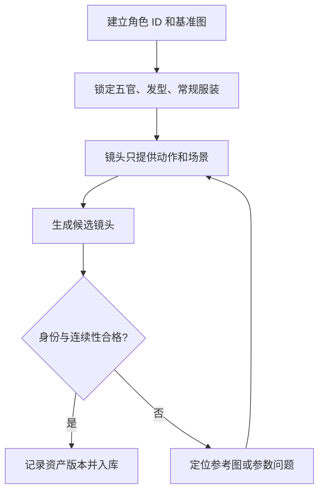

# 151｜AI 短剧角色为何会“变脸”

> **场景引入**：同一角色在两个镜头里五官和发型都变了。只重复写名字不足以保持形象，需要可复用的角色资产。

> 对应[原始材料](../origanl/151-如何解决AI短剧角色变脸？.md)。原稿来自视频二次还原；以下把观点整理为可实施方案。

---

## 🎯 一句话定位

用角色 ID、基准图和版本约束多镜头生成，再对连续性做自动筛选与人工验收。

## 💎 核心要点概览

| 环节 | 关键动作 |
| --- | --- |
| 资产 | 固定角色参考与允许变化范围 |
| 生成 | 镜头引用资产版本 |
| 验收 | 连续镜头检查辨识度与剧情一致性 |

## 🚀 核心总结

> 角色一致性依赖资产治理和连续性检查，不能只靠重复提示词。

---

## 一、先抓住问题

多镜头生成时，模型每次都可能重新理解“这个人是谁”。即使提示词相同，随机性、参考图差异、裁切和服装变化也会造成视觉漂移。需要给角色一个可复用、可追溯的身份资产。

## 二、怎么落地

角色资产包含 `character_id`、正面/侧面参考图、稳定特征、允许变化的范围、版本号。镜头文件只写该镜头的动作、表情、光线和镜头语言，并明确所用资产版本。参考图要检查压缩、裁切和是否混入旧版；角色换装应作为有记录的剧情状态，不能暗中覆盖基准形象。

质检分两层：人脸/服装相似度可做候选筛选，但最终要人工检查连续镜头中的辨识度、比例和叙事合理性。阈值要用本项目素材校准，不能把某个通用相似度当“必然一致”。

**面试表达：**“我会先做角色资产和版本治理，再让每个镜头引用固定资产生成；用自动筛选加人工连续性验收定位漂移来源，而不是无限改 Prompt。”

---

## 三、落地 Checklist

- [ ] 为角色保存 ID、基准图、稳定特征和版本号。
- [ ] 镜头文件只写场景变化，并引用明确资产版本。
- [ ] 自动筛选后人工检查连续镜头与剧情状态。

## 四、总结（一句话带走）

> **先固定角色资产，再生成和验收镜头。**
