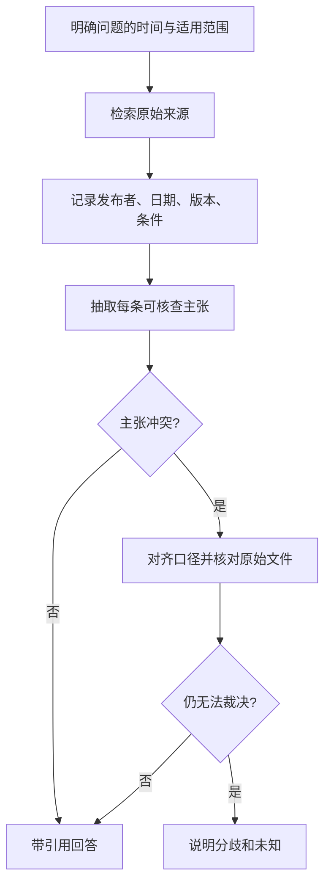

# 152｜资料越多，为何越难得出可信结论

> **场景引入**：搜索到十篇都谈某 API 的文章，其中多数在转述旧版文档。资料更多了，当前版本是否支持该参数仍未确定。

> 对应[原始材料](../origanl/152-搜得多为何越难信？.md)。原稿是视频二次还原。

---

## 🎯 一句话定位

把每条主张的来源、时间、版本和适用条件分开核对，才能从大量资料中得出可信结论。

## 💎 核心要点概览

| 维度 | 核对问题 |
| --- | --- |
| 来源 | 原始记录还是转述？ |
| 时效 | 是否适用当前版本？ |
| 口径 | 定义和条件是否一致？ |

## 🚀 核心总结

> 搜索数量不等于证据质量，冲突要先对齐口径与时间。

---

## 一、核心原因

搜索扩大了候选证据，也同时扩大了过时版本、不同口径和互相转述的数量。“相关”只说明谈的是同一主题，不说明它在提问的时间与条件下仍然有效。

## 二、证据卡片

每条主张至少记：原始链接、发布/生效日期、适用产品版本、条件、摘录位置、是否由其他来源独立证实。例如“某 API 支持参数 X”，官方文档权威，但如果对应旧版，就不能回答当前版本；第三方博客更新得晚，也可能只是复制旧内容。

冲突时先核对定义和时间：金额是含税还是未税？公告是发布日还是生效日？再比较原始记录和转述。没有可核对证据时保留不确定性，不能用模型的语气强弱“投票”。

**面试表达：**“我把来源可靠性、时效性和适用条件分开记录，按主张建立证据链；冲突先对齐口径，仍无解就明确标记待核实。”

---

## 三、落地 Checklist

- [ ] 为每条主张记录原始链接、日期、版本和条件。
- [ ] 冲突时先核对定义、发布时间与生效时间。
- [ ] 证据不足时说明分歧，不用语气强弱代替验证。

## 四、总结（一句话带走）

> **资料越多，越要按主张管理证据。**
