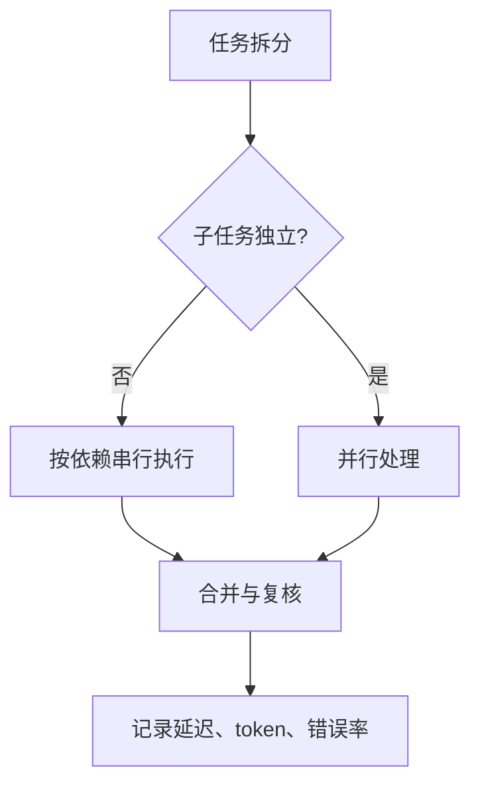

# 153｜三个 Agent 为什么可能比一个慢

> **场景引入**：检索必须先完成，分析才能开始，成稿又依赖分析。拆成三个 Agent 仍是串行，还多了交接成本。

> 对应[原始材料](../origanl/153-为什么三个Agent协同反而比一个慢？.md)。

---

## 🎯 一句话定位

多 Agent 是否提速取决于任务依赖图、关键路径和协调成本。

## 💎 核心要点概览

| 任务关系 | 执行方式 | 风险 |
| --- | --- | --- |
| 强依赖 | 串行 | 交接徒增时延 |
| 相互独立 | 可并行 | 合并与复核成本 |

## 🚀 核心总结

> 只有并行收益大于拆分、传递和合并成本，多 Agent 才可能更快。

---

## 一、用关键路径理解

总耗时不是“Agent 数量越多越短”，而是关键路径上的执行时间，加上拆分、上下文传递、等待、合并与复核成本。若任务 B 必须等 A 的结果，拆给两个 Agent 也无法并行。

## 二、一个算例

单 Agent 完成检索、分析、成稿分别用 4、5、3 秒，总计 12 秒。若检索与分析互相依赖，拆成三个 Agent 仍需走完这 12 秒，再加 2 秒交接和 2 秒合并，变为 16 秒。相反，两份完全独立的资料核验各需 5 秒，若并行且交接成本只有 1 秒，才可能省时。

实施时给子任务限定输入、输出契约和完成条件；共享证据引用，避免每个 Agent 复制整段历史；测 P50/P95 耗时、token、返工率。只有实测收益大于协调成本才增加 Agent。

**面试表达：**“先画依赖图、找关键路径。独立工作并行，有依赖的串行；比较端到端耗时和质量，避免为了架构图而拆角色。”

---

## 三、落地 Checklist

- [ ] 画依赖图并标出关键路径。
- [ ] 给子任务限定输入、输出和完成条件。
- [ ] 比较端到端 P50/P95、token 和返工率。

## 四、总结（一句话带走）

> **先找能真正并行的工作，再决定要不要增加 Agent。**
