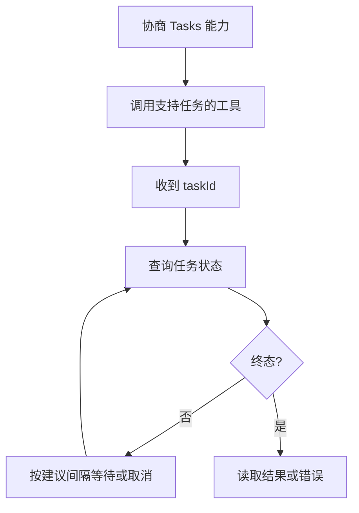

# 154｜MCP Tasks：长任务为何需要任务状态

> **场景引入**：报告生成要十分钟，浏览器中途断线。若服务返回可查询的任务句柄，重连后仍可追踪进度和结果。

> 对应[原始材料](../origanl/154-别只答异步！MCP长任务解析.md)。协议细节以 [MCP Tasks 规范](https://tasks.extensions.modelcontextprotocol.io/specification/draft/tasks) 为准。

---

## 🎯 一句话定位

MCP Tasks 将长任务生命周期与单次连接分开，靠任务句柄查询状态、结果和取消。

## 💎 核心要点概览

| 能力 | 解决的问题 |
| --- | --- |
| taskId | 重连后找到任务 |
| 状态查询 | 区分运行、输入等待和终态 |
| 结果查询 | 明确完成与业务错误 |

## 🚀 核心总结

> 异步调用只是形式，可靠状态保存和恢复才是长任务核心。

---

## 一、核心区别

普通工具调用让客户端等当前调用结束；Tasks 扩展让长操作返回任务句柄，之后查询状态、获取结果或取消。它解决的是任务生命周期与连接生命周期分离，而不只是“改成异步”。但持久化和断线恢复仍要服务端正确实现，协议本身不会替业务自动保存任务。

## 二、工程重点

服务端应先可靠登记任务，再返回句柄；同一业务请求需考虑幂等，防止重试重复执行。状态可能是 `working`、`input_required`、`completed`、`failed`、`cancelled`。`completed` 表示任务流程完成，仍需检查工具结果中的 `isError`，不能直接等同业务成功。客户端保存 taskId，控制轮询频率、超时、取消和结果保留期限。

例子：批量生成报告要跑十分钟。客户端提交后拿 taskId；浏览器断线重开仍可凭句柄继续查询。若实现只把任务状态放在原 HTTP 连接内，这种恢复能力仍不存在。

**面试表达：**“MCP Tasks 的关键是可查询的任务状态机、句柄和生命周期管理；我会核对能力协商、可靠登记、幂等、终态语义与断线恢复。”

---

## 三、落地 Checklist

- [ ] 协商 Tasks 能力并可靠登记任务后返回句柄。
- [ ] 保存 taskId、幂等信息、状态和结果保留期限。
- [ ] 检查终态结果的 `isError`，验证断线恢复和取消。

## 四、总结（一句话带走）

> **长任务要可查询、可恢复、可取消，并能核对真实结果。**
