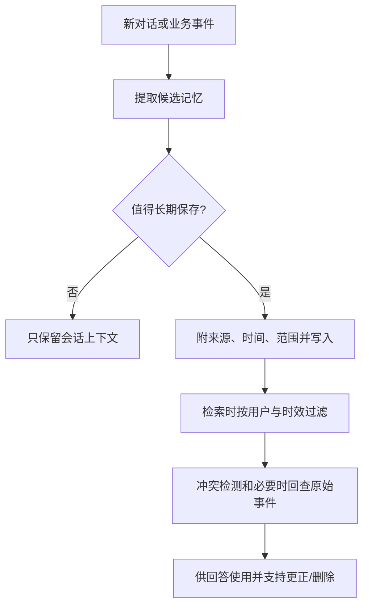

# 155｜生产级 Agent 记忆如何设计

> **场景引入**：用户上月说偏好 Go，本周明确要求 Rust。旧偏好不能覆盖当前指令，记忆需要时间、来源和更正机制。

> 对应[原始材料](../origanl/155-生产级记忆管理怎么做.md)。

---

## 🎯 一句话定位

按会话进度、长期偏好和原始事件分层保存，并用来源、时间、权限管理记忆。

## 💎 核心要点概览

| 类型 | 保存内容 | 可信边界 |
| --- | --- | --- |
| 会话状态 | 当前任务和待办 | 随任务更新 |
| 长期偏好 | 稳定偏好与更新时间 | 不能压过当前指令 |
| 事件日志 | 原始来源与更正 | 可追溯、可删除 |

## 🚀 核心总结

> 记忆是可治理的数据，不是把所有聊天塞进向量库。

---

## 一、先分清“记住什么”

当前会话的进度、用户长期偏好、可追溯的原始事件，生命周期和可信度不同，不能统统塞进向量库。尤其订单状态、金额、权限等精确信息，应查权威业务系统。

## 二、四层存储

会话状态记录当前任务与待办；短期摘要压缩较早对话，但保留原文指针；用户偏好存结构化字段及更新时间；事件日志保存原始来源与审计线索。写入前判断是否是稳定、获授权、与后续任务相关的信息；用户更正时更新版本，不让旧摘要覆盖新事实。

例如用户上月说“偏好 Go”，本周明确改用 Rust。检索应优先本周指令，长期画像只能作为建议，不能对抗当前意图。还要配置保留期限、访问控制及删除链路，避免“记忆”成为无法纠错的数据副本。

**面试表达：**“记忆是带来源、时间和权限的状态管理；我会分层存储、按当前任务检索，并处理冲突、更正和删除。”

---

## 三、落地 Checklist

- [ ] 写入前判断相关性、稳定性和用户授权。
- [ ] 检索时按用户、时效和当前任务过滤。
- [ ] 设计冲突、更正、保留期限和删除链路。

## 四、总结（一句话带走）

> **记忆要能找回，也要能纠错和删除。**
