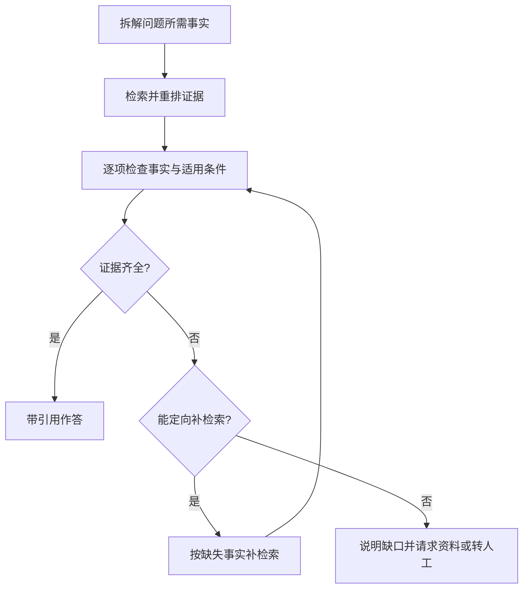

# 156｜文档相关，却无法回答问题

> **场景引入**：检索到“退款政策”，但它只讨论 200 元订单，用户问的是 500 元订单。主题相关并不代表证据足以回答。

> 对应[原始材料](../origanl/156-检索相关却无法回答怎么办？.md)。

---

## 🎯 一句话定位

回答前逐项核对证据是否覆盖对象、时间、条件和结论，缺口可补检索或澄清。

## 💎 核心要点概览

| 检查 | 结果 |
| --- | --- |
| 证据齐全 | 带引用回答 |
| 可定向补齐 | 有界补检索 |
| 关键事实缺失 | 澄清或说明无法判断 |

## 🚀 核心总结

> 检索相关性只是候选信号，可回答性取决于完整证据链。

---

## 一、相关性与可回答性

“退款政策”文档与“我这笔 500 元订单能否退款”高度相关，但若文档只写 200 元订单规则，答案依然缺证据。可回答性要求证据覆盖问题中的对象、时间、条件和结论。

## 二、两种常见缺口

多跳问题需要把 A 文档中的人物身份和 B 文档中的籍贯连起来，并确保指的是同一人；条件问题需要核对金额、地区、产品版本和生效日。拼接证据不能把不同主体的事实凑在一起。

可做“证据槽位表”：每个结论必须对应一个来源片段、适用条件和置信状态。若缺的是关键条件，就问用户补充；若知识库根本没有规则，就明确说无法确定。补检索次数要有限制，避免无限循环。

**面试表达：**“先判证据是否足以回答，再决定多跳补检索、澄清或拒答；相关片段不能替代完整证据链。”

---

## 三、落地 Checklist

- [ ] 把问题拆为必需事实和适用条件。
- [ ] 每个结论关联来源片段与主体、时间。
- [ ] 限制补检索次数，缺证据时明确说明。

## 四、总结（一句话带走）

> **先判断证据够不够，再判断怎么回答。**
