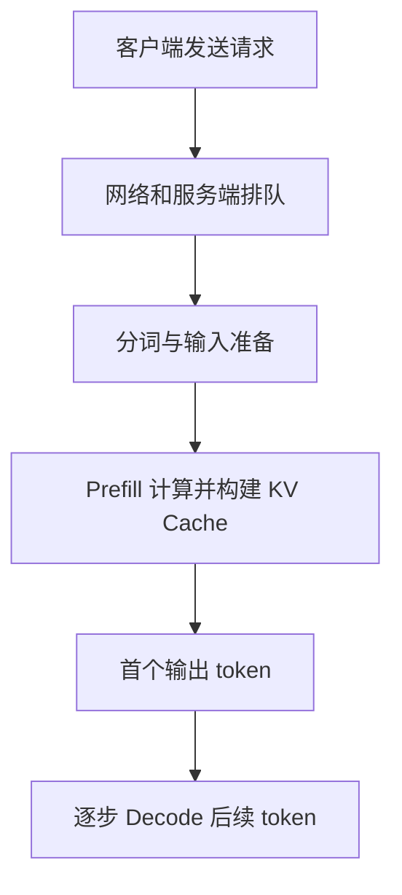

# 157｜为什么第一个 token 来得慢

> **场景引入**：用户等首字等了五秒，团队立刻怪 Prefill。实际可能有三秒花在排队，必须分段计时才知道瓶颈。

> 对应[原始材料](../origanl/157-大模型推理：为什么出第一个字特别慢？.md)。

---

## 🎯 一句话定位

首 token 时间是网络、排队、输入准备和 Prefill 等环节的总和，应分段定位。

## 💎 核心要点概览

| 指标 | 观察什么 |
| --- | --- |
| TTFT | 请求到首个输出 |
| Prefill | 输入处理和 KV Cache 构建 |
| ITL | 后续 token 之间的间隔 |

## 🚀 核心总结

> 首字慢先看各阶段耗时，后续慢再看 Decode 与传输。

---

## 一、把时延拆开

首 token 时间（TTFT）从客户端发起请求算到收到首个输出，包含网络、排队、输入预处理、模型 Prefill，若有工具调用还包含工具等待。不能把所有首字慢都归因于 Prefill。之后相邻输出的间隔（ITL）主要反映 Decode 与调度。

## 二、如何定位

分别记录请求长度、排队时间、Prefill 时间、TTFT、ITL 和输出长度。若只有长提示词慢，先缩减无关上下文或利用服务端支持的缓存；若短请求也慢，要查队列、并发和网络；若首 token 很快但后续卡顿，则检查 Decode、资源争用和流式传输。

KV Cache 缓存的是注意力计算所需的历史键值，可减少逐 token 重算，但会占显存。长上下文、并发与吞吐之间有权衡，优化时要看实际 P95，而不是单次演示。

**面试表达：**“TTFT 是端到端指标；我先分段计时，再依据瓶颈优化队列、输入长度或 Prefill，另用 ITL 看 Decode。”

---

## 三、落地 Checklist

- [ ] 记录请求长度、排队、Prefill、TTFT、ITL 和输出长度。
- [ ] 长输入慢先查上下文，短输入慢先查队列和网络。
- [ ] 以真实 P95 比较优化，兼顾 KV Cache 显存占用。

## 四、总结（一句话带走）

> **把首字时间拆开测，才能对准真正慢的环节。**
