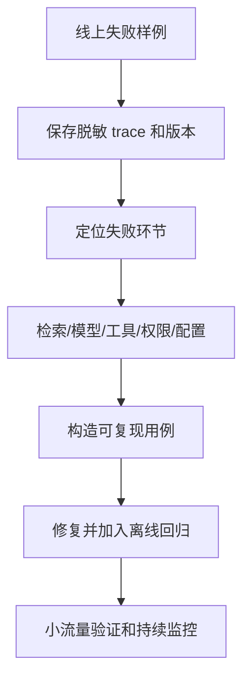

# 158｜离线评测全绿，上线却出错

> **场景引入**：离线样本全过，线上工具却返回 429、空字段和过期文档。现有评测只覆盖了过去的样本与配置。

> 对应[原始材料](../origanl/158-离线全绿上线翻车怎么答？.md)。

---

## 🎯 一句话定位

线上故障要用真实 trace 定位，并转为可复现的离线回归样例。

## 💎 核心要点概览

| 层次 | 可能差异 | 应对 |
| --- | --- | --- |
| 数据 | 问法、时效、权限 | 补真实边界样例 |
| 工具 | 429、超时、缺字段 | 故障模拟 |
| 配置 | 模型、提示、索引版本 | 固定并可回滚 |

## 🚀 核心总结

> 离线全绿只说明现有样本通过，线上反馈必须进入下一轮回归。

---

## 一、为什么会发生

离线通过只说明系统在现有样本、工具替身和配置下表现合格。真实用户的问法、权限、数据时效以及 API 超时、限流、空字段，都可能不同。它可能是数据分布变化，也可能是集成或配置问题，不能一概称为“分布漂移”。

## 二、双轨评估

离线集要覆盖常见任务、边界问题和真实工具故障：429、超时、重复返回、缺字段。线上记录任务成功率、人工接管率、错误工具调用、时延及成本，按租户、版本和场景分层观察。事故样例经脱敏和人工核实后纳入回归集，避免只挑“容易通过”的题。

发布时固定提示词、模型、工具 schema、知识库索引版本；若指标恶化可以回滚。切勿把用户私密对话原样倒入评测集。

**面试表达：**“我用线上 trace 定位具体失效层，把真实失败转为可复现回归样例，再通过小流量发布验证修复。”

---

## 三、落地 Checklist

- [ ] 线上记录脱敏 trace、模型、提示、工具和索引版本。
- [ ] 将核实后的失败样例加入离线回归，覆盖真实工具故障。
- [ ] 小流量发布并监控成功率、接管率、错误动作和尾延迟。

## 四、总结（一句话带走）

> **用线上失败校正离线评测，再用小流量验证修复。**
