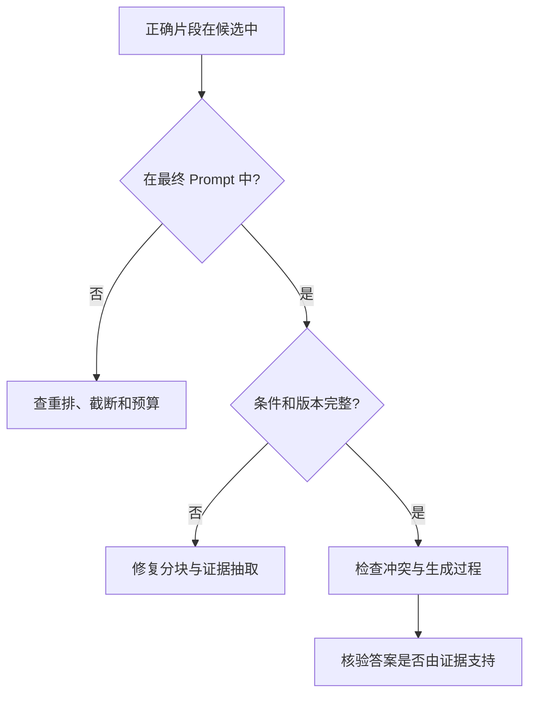

# 159｜RAG 召回对了，回答为何仍错

> **场景引入**：正确条款出现在召回前十名，最终回答仍引用旧版。应确认它是否进入最终 Prompt，以及条件有没有被截断。

> 对应[原始材料](../origanl/159-RAG召回正确为何大模型答错？.md)。原稿中的固定准确率数字不宜当作通用结论。可参阅论文 [Lost in the Middle](https://arxiv.org/abs/2307.03172)。

---

## 🎯 一句话定位

候选召回命中不等于模型看见完整证据，要追踪重排、截断、冲突与生成。

## 💎 核心要点概览

| 阶段 | 核对点 |
| --- | --- |
| 召回与重排 | 正确片段是否留下 |
| 最终上下文 | 条件和版本是否完整 |
| 生成与校验 | 结论是否受引用支持 |

## 🚀 核心总结

> 沿证据流找第一处丢失或误解，比盲目更换 Embedding 有效。

---

## 一、逐段排查

“召回正确”只证明候选结果里有答案。它可能被重排挤出最终上下文、被截断、被旧版本冲突信息覆盖，或模型虽看见却忽略条件与否定。长上下文中的信息位置会影响部分模型任务表现，但不是唯一原因。

## 二、实用改法

记录从召回、重排到最终 Prompt 的每一步文档 ID 与片段；把真正支持答案的短证据和条件一起放入上下文；要求生成结果标注引用，随后做事实核验。通过同一组样本对比不同排序、上下文长度和模型设置，才知道哪项改动有效。

**面试表达：**“我先确认正确信息是否完整进入模型，再看冲突、位置、条件和生成核验；不会因为候选命中就直接改 Embedding。”

---

## 三、落地 Checklist

- [ ] 记录召回、重排和最终 Prompt 的文档 ID 与片段。
- [ ] 检查关键条件、否定、版本是否被截断。
- [ ] 用同一评测集比较排序、长度与生成校验改动。

## 四、总结（一句话带走）

> **“召回到了”只是第一步，证据还要完整进入并支撑回答。**
