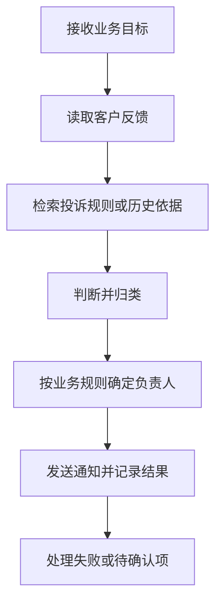

# 16. 学了 RAG 还是不会讲？先串起 Agent 知识

> **场景引入**：系统要整理客户投诉、分配负责人并发送通知。RAG 找到投诉规则，只解决了“依据从哪里来”，还没有把任务办完。

> 对应原稿：[16-学了RAG还是不会讲？先串起Agent知识-20261021](../origanl/16-学了RAG还是不会讲？先串起Agent知识-20261021.md)。原稿含课程推广；本文聚焦 RAG 与 Agent 的关系及项目讲述方法。

---

## 🎯 一句话定位

**RAG 负责为回答或决策提供外部资料；Agent 负责围绕目标选择动作、推进步骤并处理结果。** RAG 可以成为 Agent 的一个信息来源，但一个完成多步任务的系统也可能不需要 RAG。

---

## 💎 核心要点概览

| 能力 | 在投诉任务里负责什么 |
| --- | --- |
| RAG | 找到投诉定义与处理规则，并附依据 |
| 工具 | 读取反馈、查负责人、发送通知 |
| 状态 | 跟踪哪些投诉已处理、哪些待确认 |
| 权限与评测 | 防止错发、漏发，并验证任务是否真正完成 |

---

## 🚀 核心总结

> **检索可以提供证据，完成任务还需要动作、状态与验证。**

---

## 一、用客户投诉任务看区别

目标是“整理上季度客户反馈，找出投诉，分配负责人并通知”。

RAG 能帮助查找相关反馈和处理规则，回答“这条反馈是否符合投诉定义”。完整任务还包括读取数据、分类、根据业务归属找负责人、生成待发送内容、发送通知、记录结果、处理失败。这些步骤需要工作流或 Agent 的执行能力，不能把检索做好就说任务完成。

是否“动态选择下一步”取决于业务设计。若步骤与分支都已确定，这也可以主要由工作流实现；不能因为流程里调用了模型或 RAG，就自动称为自主 Agent。

## 二、面试时怎样讲完整项目

按下面顺序说，比堆框架名清楚：

1. **目标：**用户究竟要完成什么业务结果？
2. **信息：**静态制度来自哪里，实时数据来自哪里？
3. **决策：**哪些分支由规则决定，哪些需模型判断？
4. **行动：**工具能做什么，权限和参数怎样校验？
5. **异常：**检索不到、工具超时、重复发送怎样处理？
6. **验收：**如何证明分类与通知结果正确？

例如不要只说“我做了向量库和 Rerank”。要说“投诉规则有版本，检索时按生效时间过滤；分类结果附证据；发通知前按负责人映射和权限核验；邮件失败会保留任务状态并在幂等保护下重试”。

## 三、把零散知识连起来

| 学过的知识 | 在任务链路中的位置 |
| --- | --- |
| Prompt 与结构化输出 | 把分类和参数变成可校验结果 |
| RAG | 获取制度、手册等外部知识 |
| 工具调用 | 读取或改变业务系统数据 |
| 状态管理 | 记录当前做到了哪一步 |
| Trace 与评测 | 排查失败并验证改进 |
| 安全与权限 | 限制模型能触发的动作 |

每个知识点都要回答两个问题：**它解决哪种失败？如果它失效，系统会怎样表现？** 能把这两点讲透，就不容易在面试时被问断。

## 四、深度追问与自测

1. 为什么检索出正确投诉规则，仍不代表通知任务已完成？
2. 邮件接口超时后，系统怎样避免重复发送？
3. 如果全部步骤固定，你会如何描述系统中模型的职责？

**一句话带走：用业务目标串起知识点，才能把“会一个组件”变成“会完成任务”。**

---

## 五、实践 Checklist

- [ ] 能区分外部资料、实时数据和业务操作。
- [ ] 发送通知前有对象与权限校验。
- [ ] 邮件超时后能查发送状态，避免重复发送。
- [ ] 任务完成以外部结果为准，不以模型自述为准。

## 六、总结（一句话带走）

> **用一个业务目标解释 RAG、工具和状态的分工，比孤立背概念更清楚。**
