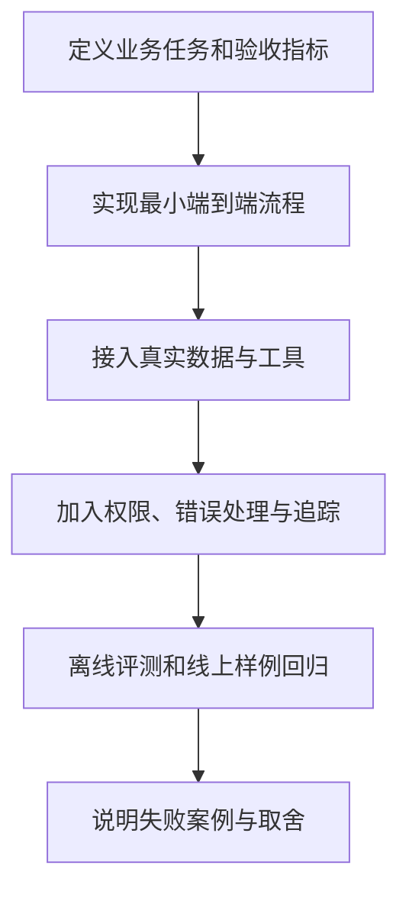

# 160｜如何判断 Agent 项目是否真有工程价值

> **场景引入**：演示能跑通客服问答，面试官追问错误引用、超时和回滚时却没有证据。项目价值要靠可复现的工程闭环说明。

> 对应[原始材料](../origanl/160-拿高薪！AI Agent企业级项目实战.md)。原稿是课程推广；薪资与涨价说法缺少可核查依据，这里只提炼项目学习方法。

---

## 🎯 一句话定位

以任务指标、故障轨迹、修复结果和部署控制展示 Agent 项目的工程价值。

## 💎 核心要点概览

| 证据 | 说明什么 |
| --- | --- |
| 任务指标 | 解决问题的程度 |
| 失败 trace | 排障与边界处理 |
| 回归和回滚 | 变更可控性 |

## 🚀 核心总结

> 功能数量不等于工程价值，关键是可验证的效果和失败处理。

---

## 一、从可演示走向可验证

一个有说服力的 Agent 项目，要让别人能复现“它解决了什么、遇到什么失败、如何修复”。功能数量不是质量指标。先选择有明确输入输出的场景，例如客服知识问答或报表生成，并定义成功率、人工接管率、延迟和成本。

## 二、作品集应展示什么

至少包含：架构图、核心代码、测试数据边界、一次真实失败的 trace、修复前后指标，以及部署与回滚方式。若涉及审批或支付，说明人工确认、幂等和审计；若涉及 RAG，展示引用与拒答策略。面试时讲清自己做过的部分，避免把教程功能当作个人线上经验。

课程可作为学习材料，但购买或完成课程不能推导出薪资结果；招聘看岗位、地区、经验与可验证成果。

**面试表达：**“我会用一个可复现的业务场景展示工程闭环：指标、故障、追踪、修复和权衡。”

---

## 三、落地 Checklist

- [ ] 明确业务任务、成功率、接管率、延迟和成本。
- [ ] 保留架构、代码、失败 trace 与修复前后指标。
- [ ] 说明部署、回滚、权限和个人实际贡献。

## 四、总结（一句话带走）

> **让别人能复现问题和验证改进，项目才有说服力。**
