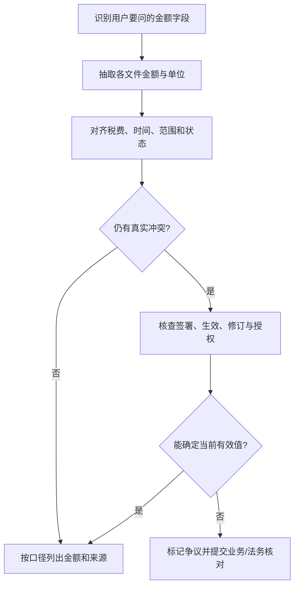

# 161｜三份合同金额不同，RAG 应信谁

> **场景引入**：主合同写含税 380 万，补充协议写不含税 336 万。两个数字可能口径不同，不能立即判定冲突。

> 对应[原始材料](../origanl/161-RAG合同金额冲突信谁？.md)。

---

## 🎯 一句话定位

先对齐金额的字段、税费、阶段和效力，再判断文件是否真正冲突。

## 💎 核心要点概览

| 核对项 | 常见差异 |
| --- | --- |
| 口径 | 含税与不含税 |
| 阶段 | 签约、审批、验收、实付 |
| 效力 | 签署、生效和修订关系 |

## 🚀 核心总结

> 模型负责找证据和解释口径，金额裁决依权威业务规则。

---

## 一、先核对是不是同一个数

主合同“含税总价 380 万”、补充协议“不含税价 336 万”、审批单“折后估算 350 万”，可能分别描述不同口径或阶段，不能直接视为互相矛盾。提问是“签约含税价”“当前应付价”还是“审批估算价”，答案也不同。

## 二、数据血缘如何做

每个金额要保留原文页码、条款号、币种、含税属性、生效日期、合同/补充协议关联 ID、签署状态。补充协议是否修改主合同的某条价格，必须看实际文字与生效条件；“主合同永远优先”或“最新文件永远优先”都不可靠。模型负责找证据和解释口径，金额裁决规则应由业务负责人确认并可审计。

**面试表达：**“先辨别字段口径，再追溯文件效力和修订关系；不能把向量相似度或固定文档等级当法律结论。”

---

## 三、落地 Checklist

- [ ] 为金额保留页码、条款、币种、税费和生效信息。
- [ ] 对齐用户要问的金额字段与业务阶段。
- [ ] 真实冲突无法裁决时交业务或法务核对。

## 四、总结（一句话带走）

> **先问“这是同一个金额吗”，再谈该信哪份文件。**
