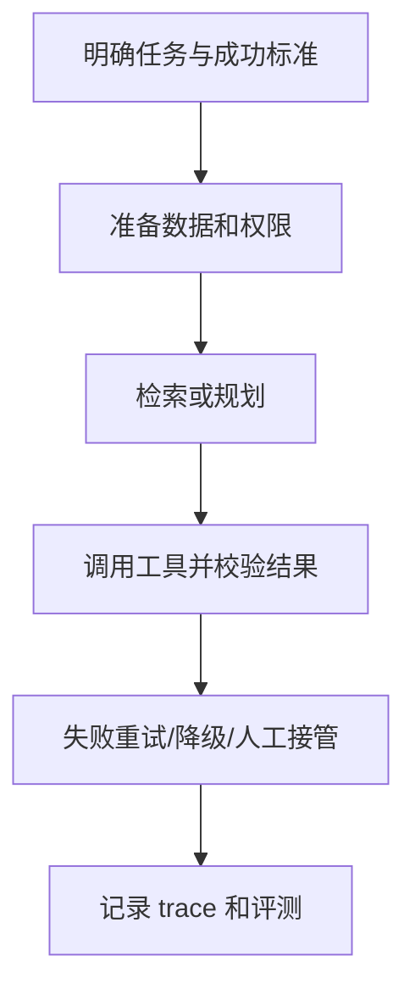

# 162｜Agent 面试如何讲出工程深度

> **场景引入**：候选人会背 RAG、MCP 和记忆，却讲不清退款接口超时后怎样确认是否已经执行。面试更看完整工程链路。

> 对应[原始材料](../origanl/162-Agent面试总挂？动画图解带你通关.md)。原稿属于课程宣传，学员数和录用结果未经独立核实。

---

## 🎯 一句话定位

围绕真实任务讲目标、数据、执行、异常与验证，并用失败案例支撑设计取舍。

## 💎 核心要点概览

| 环节 | 面试应讲清 |
| --- | --- |
| 数据 | 来源、时效和权限 |
| 执行 | 模型与业务服务职责 |
| 异常 | 超时、冲突和接管 |
| 验证 | 指标、trace 与回归 |

## 🚀 核心总结

> 会解释组件如何解决具体故障，比罗列名词更能展示工程能力。

---

## 一、用一条主线串起知识

记住 RAG、MCP、规划、记忆等名词，还不足以说明会开发 Agent。更有说服力的回答，是围绕一个真实任务讲清数据如何进入、模型能做什么、工具如何执行、失败怎样恢复、结果如何验证。

## 二、练习方法

选一个场景，例如“回答合同退款问题”。先解释为什么需要完整条款与适用条件，再说如何处理检索零召回、冲突条款、工具超时、审批与审计。每个模块都准备一个失败案例和可量化指标，比如可回答率、错误退款结论率、P95 延迟。画出架构图后，尝试口头讲三分钟，再让同伴追问一个边界问题。

作品和面试叙述应区分亲自实现、团队实现和教程复现。求职结果无法由某门课程保证，重点是可验证的工程经历。

**面试表达：**“我会按目标、数据、执行、异常、验证这条链路回答，并用一个真实失败案例说明设计取舍。”

---

## 三、落地 Checklist

- [ ] 选一项真实任务画出端到端数据与状态流。
- [ ] 每个关键模块准备一个失败案例和修复证据。
- [ ] 区分个人实现、团队实现与教程复现。

## 四、总结（一句话带走）

> **用可追问的任务链和失败证据，讲出 Agent 工程深度。**
