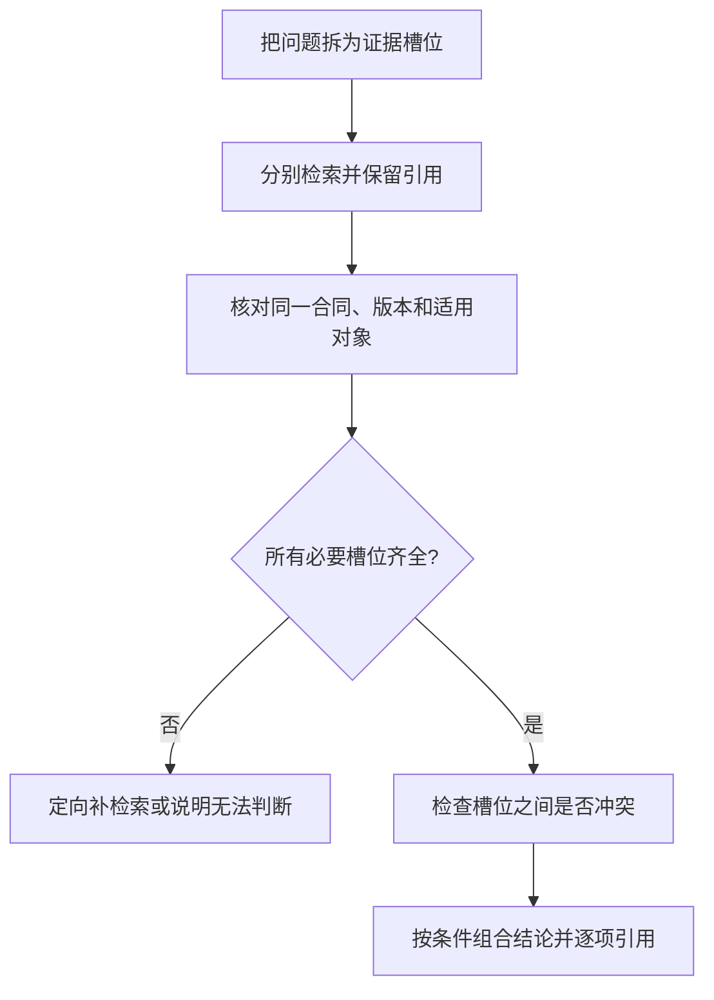

# 163｜答案散在多份文档里怎么办

> **场景引入**：年度套餐的退款资格在正文、计算方式在附件、促销例外在脚注。任何一段单独看都不足以回答用户。

> 对应[原始材料](../origanl/163-RAG召回文档不直接回答问题咋办.md)。

---

## 🎯 一句话定位

先定义答案需要的证据槽位，再跨文档检索并核对主体与版本一致性。

## 💎 核心要点概览

| 槽位 | 可能来源 |
| --- | --- |
| 退款资格 | 正文规则 |
| 金额算法 | 附件公式 |
| 例外条件 | 脚注或补充协议 |

## 🚀 核心总结

> 多篇相关文档不能直接拼成结论，必要证据必须齐全且属于同一对象。

---

## 一、像拼证据，不像拼句子

若退款结论需要“资格、金额算法、例外条款”三项证据，任何单篇文档都可能只给出一部分。需要先列出结论所需的事实，再分别寻找来源；不能把几篇相关文字直接交给模型自由发挥。

## 二、例子

用户问“已使用一个月的年度套餐能退多少”。正文写退款资格，附件写按未使用月份计算，脚注写促销套餐不退。必须先确认用户是否购买促销套餐；若是，例外可能改变结论；若未知，就应先澄清，不能套用附件公式。

实现中给每个证据槽位标注“已证实/缺失/冲突”，并保留原文位置、合同 ID 与日期。只有与同一主体、同一有效版本相匹配的片段才可组合。

**面试表达：**“先定义答案所需证据，再做多跳检索和一致性校验；缺关键槽位时停止生成确定性结论。”

---

## 三、落地 Checklist

- [ ] 列出结论所需槽位并标注已证实、缺失或冲突。
- [ ] 核对合同 ID、主体、日期和有效版本。
- [ ] 缺关键槽位时定向补检索或澄清。

## 四、总结（一句话带走）

> **先把证据拼完整，再生成条件化结论。**
