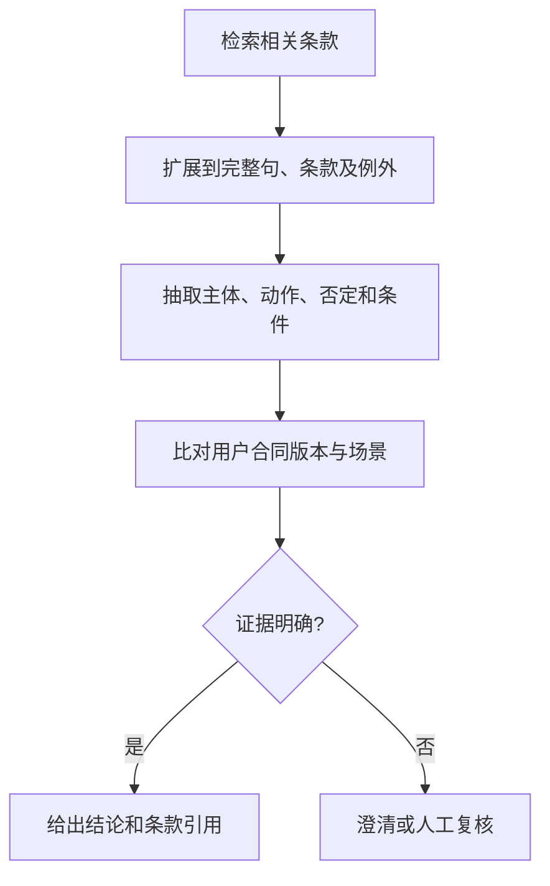

# 164｜合同写“不得退款”，系统为何答“可以”

> **场景引入**：条款写“订购后不得退款，但未开通且 24 小时内申请除外”。只截前半句或后半句都会答错。

> 对应[原始材料](../origanl/164-RAG为何分不清 不退款 ？.md)。

---

## 🎯 一句话定位

沿切片、重排和生成链路保留否定范围、条件与例外，并用原文核对结论。

## 💎 核心要点概览

| 失真点 | 后果 |
| --- | --- |
| 切片断句 | 漏“不得”或例外 |
| 重排偏向 FAQ | 正式条款被弱化 |
| 生成漏条件 | 个案结论答反 |

## 🚀 核心总结

> 否定词不是孤立标签，必须与行为、主体和例外一同理解。

---

## 一、问题不止在向量

“可退款”和“不得退款”都谈退款，主题检索可能同时召回；之后切片若切掉“不得”、重排偏向通用 FAQ、模型漏读适用条件，都可能产生错误。不能只靠否定词过滤，因为“除非”“仅在”“不适用于”等结构也会改变含义。

## 二、一个易错句

“订购后不得退款，但服务未开通且在 24 小时内申请的除外。”若只拿前半句会误拒，若只拿后半句会误批。应把主规则、例外和用户状态作为一个语义单元。召回后可用结构化抽取：`action=退款`、`default=禁止`、`exception=未开通且24小时内`，随后用原文复核。

涉及合同解释时，系统应说明依据和不确定性；最终争议需业务或法务判断。

**面试表达：**“我会保持条款语义完整，显式抽取否定的作用范围和例外，再核对用户场景。”

---

## 三、落地 Checklist

- [ ] 检索完整句、条款和相邻例外。
- [ ] 抽取主体、动作、默认规则、条件和例外。
- [ ] 用用户状态和原文核对，不明确时澄清或复核。

## 四、总结（一句话带走）

> **“不得”否定的对象和例外条件，要一起进入证据链。**
