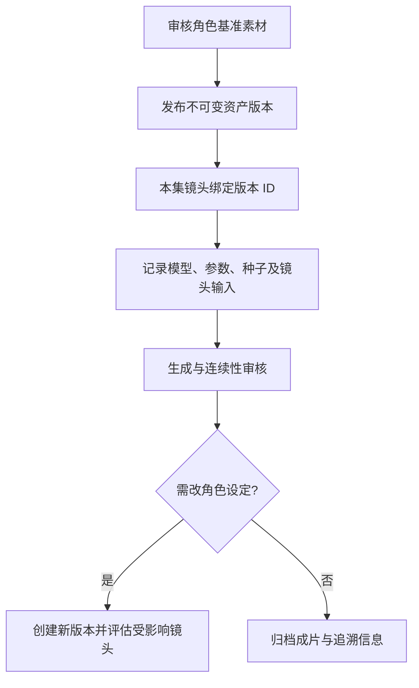

# 165｜角色一致性：为什么要锁定资产快照

> **场景引入**：同一集制作到一半，角色参考图被替换，后续镜头就和前半集不一致。锁定资产版本才能追溯差异。

> 对应[原始材料](../origanl/165-AI短剧角色总变脸？别再死磕Prompt.md)。

---

## 🎯 一句话定位

让每个镜头绑定已审核的角色资产版本，并记录生成参数与连续性验收结果。

## 💎 核心要点概览

| 记录 | 用途 |
| --- | --- |
| 角色与资产版本 | 固定身份来源 |
| 参考图哈希、模型参数 | 复现生成过程 |
| 连续性审核 | 发现跨镜头漂移 |

## 🚀 核心总结

> 角色变更应发布新版本并评估受影响镜头，而非暗中覆盖旧素材。

---

## 一、快照解决什么

同一角色的参考图、服装板、表情图若在制作中被替换，旧镜头和新镜头即使使用同一角色名，也会引用不同素材。为每一集锁定资产快照，可以让生成过程可重现、问题可定位。

## 二、怎么验证

每个镜头存储 `character_id`、`asset_version`、参考图哈希、模型版本与生成参数。制作团队变更角色形象时，新建版本，明确哪些旧镜头需要重做。自动比对可以标记面部、发型、服装颜色偏差；人工按剧情顺序查看，避免单帧相似却镜头切换突兀。

Prompt 仍可描述动作与情绪，但不应成为角色身份的唯一来源。即使锁定资产，生成模型也可能随机漂移，因此需要筛选与返工流程。

**面试表达：**“我让镜头引用已审核的角色版本，并记录生成链路；变脸时可追到素材、模型或镜头设置。”

---

## 三、落地 Checklist

- [ ] 镜头绑定 `character_id` 和 `asset_version`。
- [ ] 保存参考图哈希、模型版本和生成参数。
- [ ] 自动标记偏差，再按剧情顺序人工验收。

## 四、总结（一句话带走）

> **固定角色快照，才能复现和定位跨镜头变化。**
