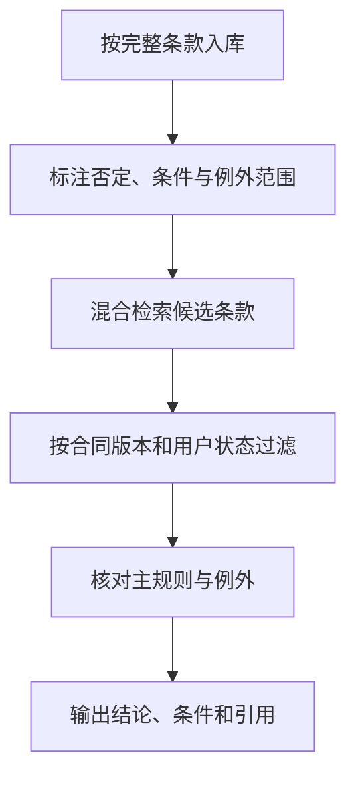

# 166｜否定条款应如何进入 RAG 证据链

> **场景引入**：给“不得退款”打否定标签后把它降权，系统反而漏掉最关键的限制条款。标签应帮助理解，不应过滤证据。

> 对应[原始材料](../origanl/166-RAG为何分不清 不得退款 ？.md)。原稿提出给否定句打标签；实施时不能因此把否定条款降权或过滤。

---

## 🎯 一句话定位

保留否定句的主体、动作、条件和例外，检索后再按用户状态判断适用性。

## 💎 核心要点概览

| 信息 | 判断问题 |
| --- | --- |
| 否定对象 | 哪个动作被禁止？ |
| 条件 | 何时适用？ |
| 例外 | 哪些情况改变默认规则？ |

## 🚀 核心总结

> 否定标签用于结构化理解，不能把决定性限制从证据链移走。

---

## 一、关键是“否定作用于什么”

“不得退款”否定的是退款行为；“未开通可退款”中的“未”限制的是服务状态。只标记存在否定词会把两种情形混淆，必须保留主语、动作、条件、例外和适用时间。

例：“会员不得退款，但开通前 24 小时内可撤销。”若用户已开通，后一条件不成立；若未开通且及时申请，例外可能成立。把“不得退款”片段降权，会让系统漏掉决定性限制。应保留两段并明确逻辑关系。

评测集至少覆盖肯定、否定、双重否定、例外、跨段落引用和版本冲突。用“违规地答可以退款”的比例衡量风险，而非只看检索相似度。

**面试表达：**“否定标签帮助理解条款，不等于过滤否定证据；我会检索完整语义单元，再核对条件与例外。”

---

## 二、落地 Checklist

- [ ] 按完整条款入库并保留否定范围。
- [ ] 召回主规则与例外，核对合同版本和用户状态。
- [ ] 评测双重否定、跨段例外和误答可退款风险。

## 三、总结（一句话带走）

> **不能把“不得”过滤掉，关键是读懂它限制了什么。**
