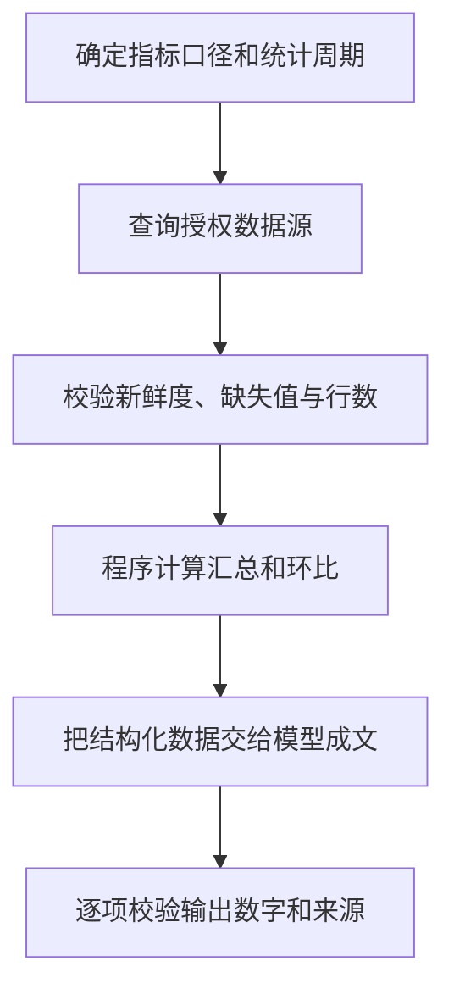

# 167｜AI 周报如何避免编造数字

> **场景引入**：CRM 同步晚了两天，模型仍写出“本周完整客户数”。报告应标注数据截止时间，缺失时暂停该指标。

> 对应[原始材料](../origanl/167-AI写周报总编造数据？这才是满分回答.md)。

---

## 🎯 一句话定位

可信数据源负责取数，代码负责计算，模型负责叙述，发布前逐项核验数字与口径。

## 💎 核心要点概览

| 环节 | 关键要求 |
| --- | --- |
| 取数 | 授权来源、时区、截止时间 |
| 计算 | 程序汇总、处理缺失值 |
| 成文 | 数字和单位可回溯 |

## 🚀 核心总结

> 原始数字正确还不够，统计口径和数据新鲜度也要正确。

---

## 一、让数字有出处

周报中的成交额、客户数、转化率应来自业务数据库或受控报表，并固定统计口径、时间范围与时区。模型适合组织语言，不应凭历史周报“猜”本周数字；计算也应由程序完成。

例如本周 20 单、上周 16 单，程序计算环比 `(20-16)/16=25%`，并附数据截止时间。若 CRM 同步延迟两天，报告应明确“截至某日”，或暂停生成该指标，不能生成看似完整的本周结果。

输出前解析文中的全部数字，与结构化输入逐一对照。也要检查单位、税额、去重口径；这些错误即使数字真实，也会产生误导。

**面试表达：**“指标由可信数据源取数、代码计算并带时间戳；模型只负责叙述，最终对数字和口径做机器校验。”

---

## 二、落地 Checklist

- [ ] 指标包记录来源、口径、周期、时区和截止时间。
- [ ] 环比同比用代码计算并处理异常分母。
- [ ] 解析输出数字并逐项核对单位和来源。

## 三、总结（一句话带走）

> **周报可信度来自数据链路，不来自模型写得流畅。**
