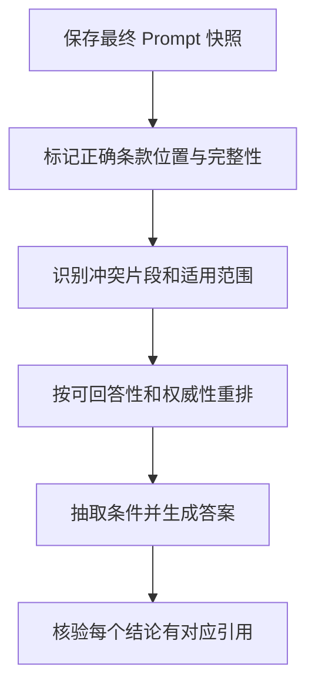

# 168｜正确证据进入上下文后仍答错

> **场景引入**：正确条款已在最终 Prompt 中，模型仍把“未使用权益”条件漏掉。问题转到证据使用和答案校验环节。

> 对应[原始材料](../origanl/168-RAG召回正确为何模型还答错？.md)。

---

## 🎯 一句话定位

证据进入上下文后，还要检查权威性、位置、冲突和条件是否被正确用于结论。

## 💎 核心要点概览

| 检查 | 可能修法 |
| --- | --- |
| 条款被泛化 FAQ 淹没 | 按效力和可回答性重排 |
| 条件未匹配用户 | 结构化抽取并澄清 |
| 结论无引用支持 | 生成后校验 |

## 🚀 核心总结

> 对相同样本比较证据前置、精简上下文和条件校验，按结果选择修法。

---

## 一、检查证据的使用过程

已知“72 小时内且未使用权益才可全额退款”，模型却答“都可以退”，就应检查：是否把条件句与 FAQ 混排；是否把高相似度但低权威的泛化解释放在前面；是否没有核对用户是否满足“未使用”。信息位置可能影响表现，但不能预设它是唯一原因。

重排不能只按问题与片段的语义相似度；还要保留正式条款、版本与例外。对同一批评测样本分别试验“原排序”“证据前置”“精简上下文”，比较条件遗漏率和错误结论率。若模型仍漏条件，应增加结构化判断或业务规则校验，而不是继续堆 Prompt。

**面试表达：**“我会用最终 Prompt 和引用追踪证据是否被正确使用，再实测重排、压缩与条件校验的收益。”

---

## 二、落地 Checklist

- [ ] 保存最终 Prompt 与正确条款的位置、完整性。
- [ ] 标记冲突片段及用户缺失条件。
- [ ] 比较排序、压缩、规则校验前后的错误率。

## 三、总结（一句话带走）

> **看见证据不等于用对证据，还要核对条件和引用。**
