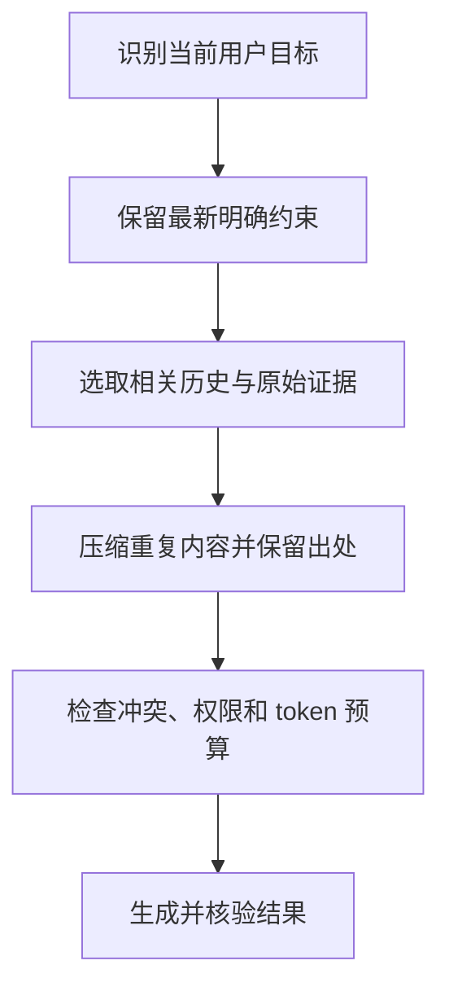

# 169｜上下文窗口有空间，为什么还要筛选

> **场景引入**：用户刚说“这次不要坐飞机”，长历史却反复出现“偏好飞机”。把全部记录塞进上下文可能掩盖最新约束。

> 对应[原始材料](../origanl/169-大模型上下文为何不能全塞满？.md)。原稿中的“注意力平均分配”“冲突指数增长”不是通用定律。

---

## 🎯 一句话定位

上下文要按当前任务筛选证据与最新约束，兼顾质量、延迟和成本。

## 💎 核心要点概览

| 内容 | 处理原则 |
| --- | --- |
| 当前明确约束 | 优先保留 |
| 相关证据 | 保留来源和适用条件 |
| 重复日志与旧偏好 | 压缩或按需读取 |

## 🚀 核心总结

> 窗口容量是上限，不是必须填满的目标。

---

## 一、装得下不代表都相关

旧对话、重复检索片段和工具日志会增加成本、延迟与冲突机会，也可能使模型遗漏关键条件。模型并非简单平均看待每个 token；实际效果要按任务和模型评测。

例：用户之前想订北京机票，后来明确“这次不要坐飞机”。后一句是当前任务的约束；历史偏好可以帮助理解背景，却不能盖过最新指令。摘要若写成“用户喜欢飞机出行”，还需保存原文指针与更新时间，防止摘要继续误导。

评估策略时比较正确率、条件遗漏率、P95 时延和成本。上下文裁剪是证据选择与状态管理，不是单纯压到某个固定 token 数。

**面试表达：**“我按当前任务保留必要证据和最新约束，去掉重复噪声，并用真实样本验证裁剪效果。”

---

## 二、落地 Checklist

- [ ] 当前任务约束优先于旧偏好和旧摘要。
- [ ] 压缩重复内容并保留原文指针与时间。
- [ ] 用正确率、条件遗漏率、P95 和成本验证筛选策略。

## 三、总结（一句话带走）

> **只装当前任务需要且可信的内容。**
