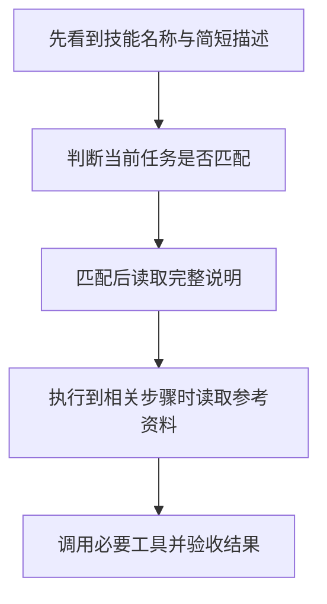

# 17. Agent Skill 是什么？把重复工作沉淀成可复用技能

> **场景引入**：每次整理会议纪要都要重申“决定和建议分开写、待办有负责人和期限、不确定处标待确认”。反复出现的做法值得整理成可复用说明。

> 对应原稿：[17-Agent Skill是什么？把重复工作沉淀成可复用技能](../origanl/17-Agent Skill是什么？把重复工作沉淀成可复用技能.md)。

---

## 🎯 一句话定位

**Skill 是针对一类重复任务的可复用工作说明。** 它写明什么时候用、需要什么输入、按什么步骤做、怎样检查结果，还可以引用配套资料或脚本。它让经验有机会复用，但不会因为写成 Markdown 就自动保证执行正确。

---

## 💎 核心要点概览

| 要素 | 应回答的问题 |
| --- | --- |
| 触发条件 | 什么时候用，什么时候不该用 |
| 输入与步骤 | 拿到什么材料，按什么顺序处理 |
| 输出契约 | 结果包含哪些字段或段落 |
| 验收标准 | 怎样检查遗漏、误解与越权 |
| 工具边界 | Skill 可建议动作，执行仍受工具权限约束 |

---

## 🚀 核心总结

> **Skill 把稳定经验写成可检查的工作说明；质量还要靠真实样本验证。**

---

## 一、从会议纪要说起

每次整理会议，你都要重复交代：“分清决定和建议；待办写负责人、截止时间；不确定的信息标注待确认。”如果这是一项稳定的工作，就把规则整理成“会议纪要 Skill”。下次输入转写稿时，Agent 可以按同一套流程处理。

| 概念 | 它回答的问题 | 会议纪要例子 |
| --- | --- | --- |
| 临时提示词 | 这一次要做什么？ | “请整理今天这场会” |
| Skill | 同类会议以后怎么做？ | 统一步骤、输出格式和检查清单 |
| Tool | 具体能执行什么动作？ | 读取录音、写文件、发送邮件 |

Skill 可以规定何时调用 Tool，但真正的文件读写和外部操作仍由工具及其权限机制执行。

## 二、一份好 Skill 至少写清五件事

1. **适用场景：**什么输入、什么目标会触发。
2. **不适用场景：**相似但不应触发的任务是什么。
3. **执行步骤：**先提取事实，再归类决定和待办，最后核对原文。
4. **输出契约：**标题、字段、缺失值怎样表示。
5. **验收标准：**负责人是否来自原文，无法确认的日期是否被标记。

例如“生成纪要”太模糊；“对会议转写稿提取已达成的决定与待办，未提及的负责人写‘待确认’，不得自行补全”就可检查得多。

## 三、按需加载怎么理解

具体加载方式取决于所用平台。按需加载的好处是不用在每次任务开始时塞入所有 Skill 全文；触发后读入的说明、参考资料和工具调用仍会产生相应成本。技能描述写得太宽泛，还可能误命中其他任务。

## 四、从零做一个 Skill

选一个高频、步骤稳定、结果可验收的任务；先用人工方式做几次，记录真正有效的做法；把输入、步骤、边界与检查点写入技能文件；用正常案例、缺失信息案例和相似但不适用的案例测试；发现漏项后修改并回归。

不要把所有背景材料复制进主文件。只保留执行时必须常读的内容，较长的参考资料按步骤引用。也不要把“请认真检查”当成验收标准，要写出具体可判定的条件。

导入他人 Skill 时，先看它依赖哪些脚本、工具和外部服务，以及是否会读写文件或发送网络请求。逐个测试，确认与自己的业务目标和权限环境匹配后再启用。

## 五、常见误区

- **“Skill 就是更长的 Prompt。”** 它还需要触发边界、复用方式和验收机制。
- **“Markdown 标题能强制模型执行。”** 标题帮助阅读，不会替代程序校验。
- **“按需加载等于零成本。”** 调用后照样要消耗上下文与工具资源。
- **“收集越多 Skill 越强。”** 相似技能太多可能增加误选与维护成本。

## 六、面试口述版

> 我把 Skill 看作封装一类任务 SOP 的可复用资源，包含触发条件、禁用边界、步骤、输出契约与验收标准。系统可以先用简短描述判断是否加载，真正执行时再读完整说明和必要参考资料。Skill 负责“怎么做”，Tool 负责“能执行什么”；最终质量要用真实样本和负例验证，不能只靠 Markdown 排版。

**自测：**为什么“整理会议纪要”需要不适用场景？Skill 中写“必须发送邮件”是否等于它已经获得发信权限？

**一句话带走：把稳定经验写清、测过并持续维护，才叫可复用技能。**

---

## 七、实践 Checklist

- [ ] 说明触发条件、不适用条件和输入要求。
- [ ] 步骤能被另一位开发者复现，输出可检查。
- [ ] 高风险工具调用仍走权限和确认机制。
- [ ] 有正例、反例和维护责任人。

## 八、总结（一句话带走）

> **可复用技能是经过验证的任务方法，不是一段写得漂亮的 Markdown。**
