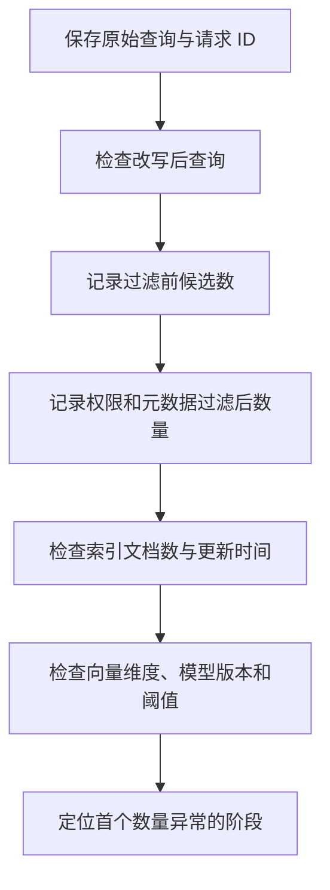

# 170｜RAG 零召回，先查哪一层

> **场景引入**：过滤前有 80 条候选，租户过滤后一条不剩。此时先核对租户标签和权限规则，比调大 `top_k` 更有意义。

> 对应[原始材料](../origanl/170-RAG零召回先查向量库？.md)。

---

## 🎯 一句话定位

沿查询改写、索引、候选、过滤和阈值逐层数数量，找第一个归零点。

## 💎 核心要点概览

| 归零位置 | 优先检查 |
| --- | --- |
| 候选前 | 索引、Embedding、查询改写 |
| 权限过滤后 | 租户与访问标签 |
| 阈值后 | 阈值和重排配置 |

## 🚀 核心总结

> 零召回是链路现象，不能预设向量库有问题。

---

## 一、不要预设故障点

零召回可能发生在空查询、改写错误、权限/元数据过滤过严、索引缺数据、Embedding 版本不匹配或阈值过高。原稿强调先查过滤是有用经验，但实际顺序应由分段指标和近期变更决定。

例如过滤前有 80 条、租户过滤后为 0，先核对租户 ID 与权限标签；若过滤前就是 0，则看索引覆盖、Embedding 和查询改写。不能为让结果“出现”而去掉权限过滤，这会变成数据泄露。调大 `top_k` 也无法修复空索引或错误租户。

上线应监控每阶段候选数、索引新鲜度和按租户划分的零召回率。一次故障后补回归测试，覆盖该租户和过滤组合。

**面试表达：**“我沿数据流统计每一层候选数，找首个归零点，再针对过滤、索引或向量链路修复。”

---

## 二、落地 Checklist

- [ ] 保存失败请求的原始与改写查询。
- [ ] 记录每层候选数、索引新鲜度和过滤条件。
- [ ] 修复后按租户回归，不能靠关闭权限过滤恢复结果。

## 三、总结（一句话带走）

> **先定位哪一步变成零，再修那一步。**
