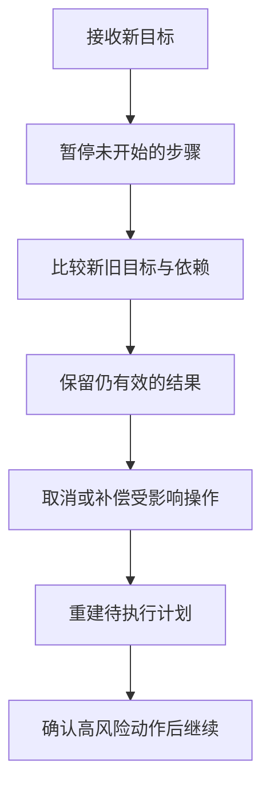

# 171｜Agent 执行途中，用户改了目标

> **场景引入**：用户从“订北京机票”改为“查火车”。如果机票已付款，就不能只在计划里删掉订票步骤。

> 对应[原始材料](../origanl/171-Agent中途改目标怎么处理.md)。

---

## 🎯 一句话定位

目标变化时先暂停旧计划，检查已发生副作用，再重建未执行步骤。

## 💎 核心要点概览

| 步骤状态 | 处理 |
| --- | --- |
| 尚未执行 | 取消或重规划 |
| 已查询 | 评估能否复用 |
| 已付款等副作用 | 查状态并补偿或人工处理 |

## 🚀 核心总结

> 新目标覆盖旧意图，但不能抹掉已经发生的真实动作。

---

## 一、把计划看成可更新的状态

用户从“订北京机票”改成“改查火车”，Agent 不能仅在最后补一句“已改目标”。应检查哪些步骤尚未执行、哪些结果还能复用、哪些外部操作已经产生副作用。

例如只查过机票价格，可丢弃该结果并改查火车；若已付款，不能把付款节点从计划中直接删除，需要查实际交易状态并走退款或人工处理。每个步骤记录输入、输出、状态和外部操作 ID，才能知道是否可复用、是否需要补偿。

目标变化后给计划版本号，并用当前用户指令覆盖旧意图。重规划之前要停止旧计划的后续工具调用，避免新旧执行并发造成重复下单。

**面试表达：**“我会暂停执行、比较新旧依赖、保留有效结果，并对已产生的副作用做状态核查与补偿。”

---

## 二、落地 Checklist

- [ ] 立即停止旧计划尚未开始的工具调用。
- [ ] 为每步记录计划版本、状态和外部操作 ID。
- [ ] 已执行动作先核对真实状态，再决定补偿与继续。

## 三、总结（一句话带走）

> **改目标先停、再核对、再重规划。**
