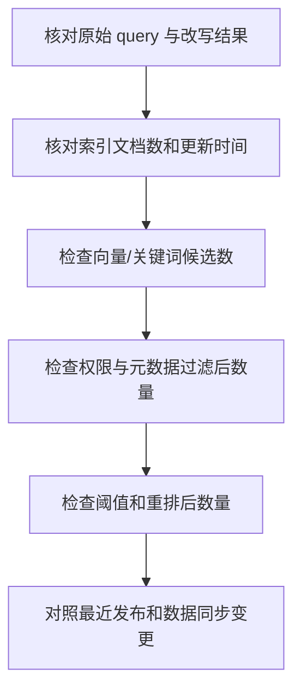

# 172｜线上 RAG 突然零召回的排查路径

> **场景引入**：昨晚发布后某租户突然搜不到文档，其他租户正常。应按请求 ID 检查该租户的索引和过滤链路。

> 对应[原始材料](../origanl/172-线上RAG零召回怎么排查？.md)。

---

## 🎯 一句话定位

线上零召回要按失败请求逐层重放，并对照最近发布和数据同步变更。

## 💎 核心要点概览

| 现象 | 重点排查 |
| --- | --- |
| 全局突然为零 | 入库和索引任务 |
| 单租户为零 | 权限标签和租户映射 |
| 特定问法为零 | 改写、词法与阈值 |

## 🚀 核心总结

> 监控分阶段候选数，才知道结果在哪个节点消失。

---

## 一、先定位归零点

零召回是最终现象，故障可能在查询入口、索引构建、权限过滤、检索配置或结果阈值。先拿一个失败请求 ID，重放各阶段并统计数量，避免盲调 `top_k`。

若索引文档数一夜降为零，检查同步任务“成功”日志是否只表示任务完成，而非写入有效文档。若仅某租户为零，核对租户标签与访问控制；不能关闭权限过滤作为长期修复。若只有含错字的查询为零，检查查询改写及混合检索。

监控应分阶段：原始文档数、成功入库数、各过滤后候选数、索引滞后时间和零召回率。修复后以故障 query 做回归，并比较其他租户有无越权召回。

**面试表达：**“我用失败请求沿查询、入库、检索、过滤和重排分段重放，找出第一个归零的节点。”

---

## 二、落地 Checklist

- [ ] 用请求 ID 回放查询改写、索引、召回、过滤与重排。
- [ ] 监控文档数、入库数、索引滞后和按租户零召回率。
- [ ] 故障 query 加入回归，检查修复未引发越权召回。

## 三、总结（一句话带走）

> **按失败请求追踪首个归零节点。**
