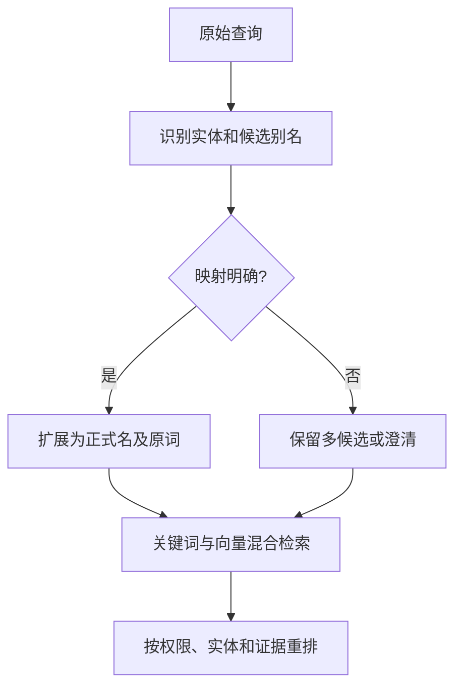

# 173｜简称、别名、错字如何召回正确文档

> **场景引入**：员工说“费审”，正式文档却只写“费用审批系统”。受控别名映射可以补召回，同时保留原词供核查。

> 对应[原始材料](../origanl/173-RAG：用户搜错字别名怎么召回？.md)。

---

## 🎯 一句话定位

用可审核的实体别名扩展查询，歧义时保留候选或澄清，再做混合检索。

## 💎 核心要点概览

| 情况 | 处理 |
| --- | --- |
| 唯一别名 | 扩展正式名与原词 |
| 歧义简称 | 保留候选或澄清 |
| 错字 | 候选纠错并验证误召 |

## 🚀 核心总结

> 查询改写要可追踪，不能让模型偷偷把歧义词定成某个实体。

---

## 一、先识别业务实体

员工问“费审在哪”，正式文档写“费用审批系统”。只用字面搜索可能漏掉；只用向量搜索又可能召回相似却无关的制度。应维护可审核的别名映射，并保留原始查询。

词典字段可包括正式名、别名、适用部门、有效时间、来源及审核人。查询改写要可解释：“费审”映射为“费用审批系统”，而非让模型擅自把“采通”定成某个产品。错字可用候选纠错，但候选不唯一时保留原词并询问用户。

评测要按正式名、别名、错字、歧义简称分别统计召回率和误召率。还需检查改写后是否跨越租户权限。

**面试表达：**“用受控实体词典做可追踪扩展，结合混合检索；有歧义时不强行归一，按场景验证误召。”

---

## 二、落地 Checklist

- [ ] 词典保存正式名、别名、部门、有效时间和审核来源。
- [ ] 保留原始查询与改写记录，歧义时不强行归一。
- [ ] 分别测正式名、别名、错字和歧义的召回率与误召率。

## 三、总结（一句话带走）

> **别名映射帮用户找对文档，歧义仍需核对。**
