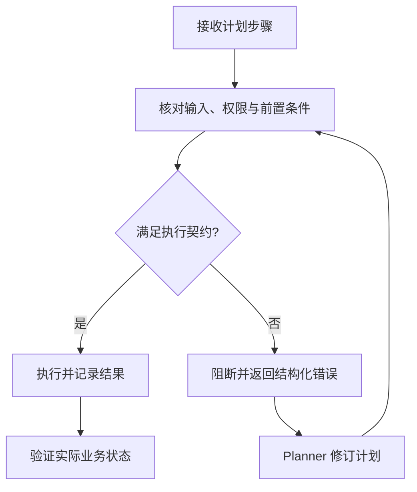

# 174｜执行器发现计划有误，应该怎么办

> **场景引入**：规划器要求删除旧索引，执行器发现新索引尚未预热。执行器应阻断删除，并把可核查的前提失败反馈给规划器。

> 对应[原始材料](../origanl/174-多智能体：执行器发现计划有误咋办.md)。

---

## 🎯 一句话定位

执行器在每一步核对前置条件与权限，不满足契约就拒绝并返回结构化事实。

## 💎 核心要点概览

| 角色 | 职责 |
| --- | --- |
| Planner | 修订计划与依赖 |
| Executor | 校验并执行合规步骤 |
| 审批者 | 决定高风险动作 |

## 🚀 核心总结

> 计划是建议，执行边界由前置条件、权限和审批决定。

---

## 一、执行前必须校验前提

Planner 提议“删除旧索引”，但 Executor 发现新索引尚未预热。此时继续执行会使线上检索中断。执行器应拒绝该步骤、报告可核查的原因，并交由规划器修订；高风险动作还需审批。

结构化反馈应包括失败条件、观测值、影响范围、可行替代步骤和是否已有副作用。例如 `new_index_ready=false`、`old_index_deleted=false`。Planner 不应无限重试相同方案；可设置重规划次数和人工接管阈值。执行器也不应私自将“删除”改成另一个高风险操作。

**面试表达：**“执行器对计划做前置条件和权限校验，失败就阻断并反馈事实，由规划器重规划，高风险操作走审批。”

---

## 二、落地 Checklist

- [ ] 每步定义输入、权限、前置条件和完成验证。
- [ ] 反馈观测值、影响范围和是否已有副作用。
- [ ] 限制重规划次数，高风险替代动作重新审批。

## 三、总结（一句话带走）

> **执行器发现计划前提不成立，就停止并回传事实。**
