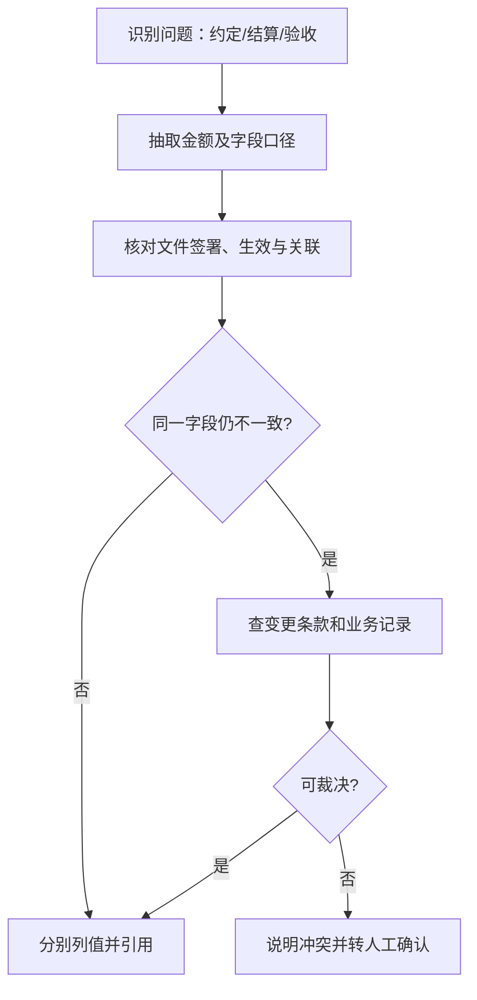

# 175｜合同约定额与验收额不能混为一谈

> **场景引入**：主合同 100 万、补充协议 98 万、验收单 95 万。用户问“实付多少”时，这三份材料可能都不是最终答案。

> 对应[原始材料](../origanl/175-RAG：三份合同数字冲突信哪个？.md)。

---

## 🎯 一句话定位

先识别用户问的是约定、结算、验收还是实付，再追溯文件效力和业务记录。

## 💎 核心要点概览

| 金额 | 常见来源 |
| --- | --- |
| 约定额 | 合同及补充协议 |
| 验收额 | 验收单 |
| 实付额 | 支付或财务流水 |

## 🚀 核心总结

> 数字不同不一定冲突，字段和业务阶段不同更不能混答。

---

## 一、先回答用户问的“哪个金额”

主合同 100 万、补充协议 98 万、验收单 95 万，不一定是三份材料争同一事实：前两者可能描述约定价的修订，验收单可能描述实际验收额。只有字段定义和生效关系对齐后，才能判断冲突。

存储金额时保留文件 ID、页码、币种、税费、阶段和关联项目 ID。若补充协议只调整某批次价格，不能把 98 万覆盖整个主合同。若用户问“实付金额”，合同和验收单也可能都不够，需要付款记录。

**面试表达：**“我按业务字段、版本和生效范围追溯金额，引用证据并明确不能从现有资料推断的部分。”

---

## 二、落地 Checklist

- [ ] 金额保存文件 ID、条款、币种、税费和业务阶段。
- [ ] 核对补充协议修改的是哪一批次和哪一字段。
- [ ] 问实付时查询支付记录，证据不足则说明缺口。

## 三、总结（一句话带走）

> **先分清问的是哪一种金额，再选择对应证据。**
