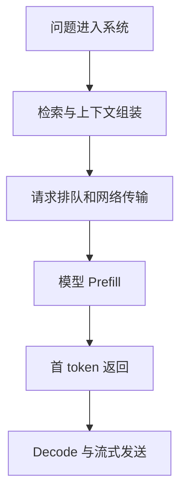

# 176｜首字延迟：Prefill 与 Decode 怎么区分

> **场景引入**：客服 Agent 首字慢，长工单可能拉长 Prefill，服务器排队也可能占大头。优化前要分段测量。

> 对应[原始材料](../origanl/176-首字延迟与推理性能解析.md)。

---

## 🎯 一句话定位

Prefill 处理输入，Decode 逐 token 输出；用户首字时间还包含外部工具、网络和排队。

## 💎 核心要点概览

| 指标 | 作用 |
| --- | --- |
| TTFT | 端到端首 token 时间 |
| Prefill | 输入处理成本 |
| ITL | 后续输出节奏 |

## 🚀 核心总结

> 分清外部等待、Prefill 和 Decode，再选压缩、缓存或扩容。

---

## 一、两段计算

Prefill 处理整段输入并建立用于后续生成的 KV Cache；Decode 随后逐 token 产生输出。用户感知的首字延迟还包含检索、工具、网络和排队，因此要端到端分段测量。

客服 Agent 把完整工单、半年聊天和大量日志一并输入，可能拉长 Prefill；但如果服务器排队占大头，删掉一半输入也未必改善用户体验。记录每段 P50/P95、输入长度、缓存命中率和并发量，再选择压缩上下文、缓存、扩容或调度优化。

区分 TTFT（请求至首 token）与 ITL（后续相邻 token 间隔）。输出很长时，即便 TTFT 优秀，整体完成时间仍可能很慢；需要一起看完成时延和质量。

**面试表达：**“先拆首字耗时，再据 Prefill、队列或外部工具瓶颈选方案；Decode 用 ITL 单独观测。”

---

## 二、落地 Checklist

- [ ] 记录检索、工具、排队、Prefill、TTFT 和 ITL。
- [ ] 按 P50/P95 与输入长度、并发量关联分析。
- [ ] 同时观察完整完成时间和答案质量。

## 三、总结（一句话带走）

> **首字慢先定位阶段，别直接把问题归给模型计算。**
