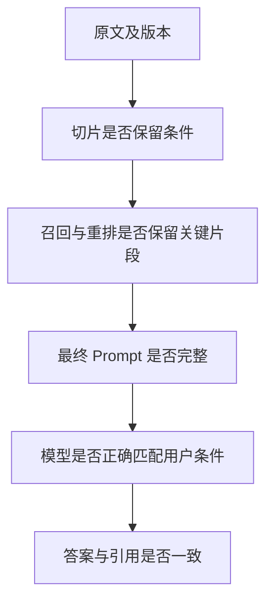

# 177｜RAG 命中正确文档，怎样定位答案错误

> **场景引入**：会员文档同时写普通套餐可退、促销套餐不可退。用户套餐类型未知时，即使命中文档也不能给确定结论。

> 对应[原始材料](../origanl/177-RAG召回对却答错？大模型解析.md)。

---

## 🎯 一句话定位

从原文、切片、重排、最终 Prompt 到答案逐层追踪，找证据第一次失真的位置。

## 💎 核心要点概览

| 阶段 | 常见故障 |
| --- | --- |
| 切片 | 例外被切走 |
| 重排 | 通用 FAQ 压过正式条款 |
| 生成 | 未匹配用户条件 |

## 🚀 核心总结

> 命中文档只是候选正确，最终结论还取决于条件识别和证据使用。

---

## 一、按证据生命周期排查

会员退费文档同时有“普通套餐可退”和“促销套餐不可退”。若系统未识别用户套餐类型，检索再准也不足以得出确定结论。排查要从原文一路追到最终答案。

固定长度切片可能把“促销套餐除外”切走；重排可能把泛化 FAQ 放在正式条款前；生成可能把两个套餐混成一个。每个节点记录文档 ID、片段、规则版本和用户条件，找出第一个失真的地方。修复方式可能是保留完整条款、调整重排、补问套餐类型，或在生成后做条件校验。

评测不仅看最终正确率，还看证据进入率、条件识别率、无证据时拒答率。

**面试表达：**“我用可追踪链路定位证据在哪一步失真，再针对该层修复，而不是把所有错误归因于模型。”

---

## 二、落地 Checklist

- [ ] 记录每阶段文档 ID、片段、版本和用户条件。
- [ ] 找首个失真点，针对分块、重排或生成修复。
- [ ] 评测证据进入率、条件识别率和无证据拒答率。

## 三、总结（一句话带走）

> **沿证据生命周期排障，别把所有错答都归咎于模型。**
