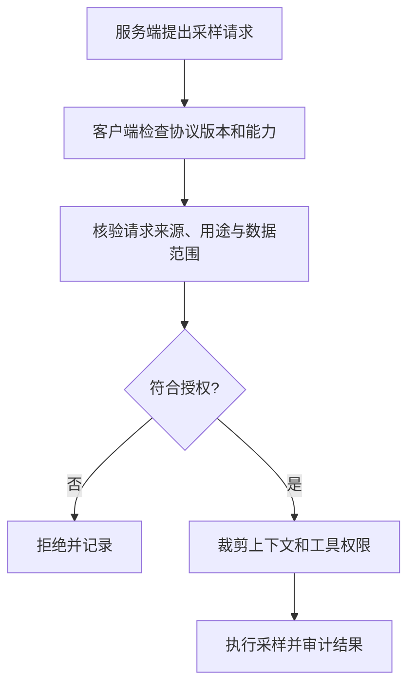

# 178｜MCP 服务端请求模型采样时，权限边界在哪

> **场景引入**：文档分析服务只需总结选中的片段，却请求客户端附上整个工作区。客户端必须裁剪上下文和权限。

> 对应[原始材料](../origanl/178-MCP架构评审：模型采样权限边界设计.md)。[MCP Ruby SDK 文档](https://ruby.sdk.modelcontextprotocol.io/server/sampling/)指出：`sampling/createMessage` 在 2026-07-28 协议版本已弃用，旧版本仍支持；设计时应先确认所用版本。

---

## 🎯 一句话定位

支持旧版 Sampling 时，服务端可请求采样，但客户端仍控制授权、上下文和工具权限。

## 💎 核心要点概览

| 检查 | 边界 |
| --- | --- |
| 协议版本 | 是否支持该能力 |
| 上下文 | 仅提供获授权片段 |
| 工具 | 模型输出不自动获得执行权 |

## 🚀 核心总结

> 服务端发起请求不等于继承客户端全部权限。

---

## 一、旧版 Sampling 的信任边界

在支持该能力的连接中，服务端可向客户端请求模型生成。但服务端提出请求，不等于拥有客户端全部上下文、工具或用户权限；客户端必须限制请求内容、可用能力和结果流向。

例如文档分析服务只需总结用户选中的文件片段，客户端不应附上其他会话、全部工作区或高危工具。即便模型返回“应删除文件”，这也只是文本输出，不能自动提升为执行权限。敏感业务应让用户审阅请求与结果，并记录调用链。

在新版系统中，优先按当前协议和客户端能力重新设计调用路径；不要把已弃用的 Sampling 当成所有 MCP 应用的标准必备能力。

**面试表达：**“先确认协议版本；在支持 Sampling 的旧版连接上，由客户端控制授权、上下文裁剪、工具权限和审计。”

---

## 二、落地 Checklist

- [ ] 按当前 MCP 协议版本确认能力和弃用状态。
- [ ] 客户端校验来源、用途、数据范围及用户授权。
- [ ] 裁剪上下文和工具能力，并记录敏感调用链。

## 三、总结（一句话带走）

> **Sampling 的请求入口在服务端，权限决定权仍在客户端。**
