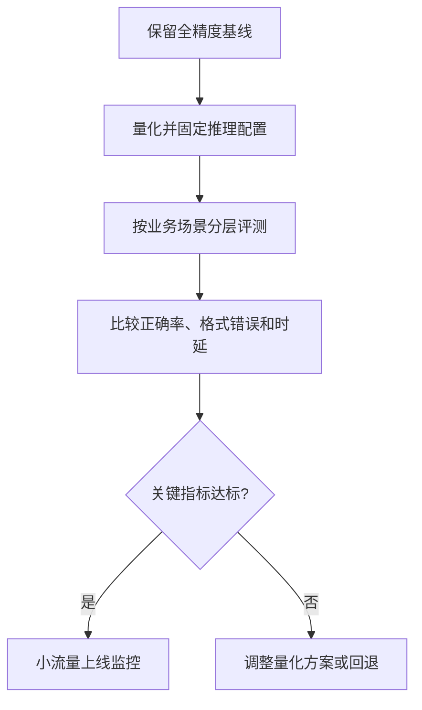

# 179｜4-bit 量化后，先检查哪些能力

> **场景引入**：量化模型聊天看似正常，却在支付工具调用中漏必填字段。应按业务风险逐项评测，而非只看平均分。

> 对应[原始材料](../origanl/179-大模型4bit量化后，哪些能力最先下降？.md)。

---

## 🎯 一句话定位

4-bit 量化的质量变化取决于模型和方案，必须与全精度基线做任务分层对比。

## 💎 核心要点概览

| 评测面 | 重点 |
| --- | --- |
| 功能 | 工具参数、JSON、条件读取 |
| 性能 | 显存、吞吐、TTFT |
| 风险 | 关键任务错误率 |

## 🚀 核心总结

> 量化收益要与关键任务退化一起衡量，没有通用退化顺序。

---

## 一、没有统一的“最先下降”榜单

4-bit 量化把部分权重用更少位数表示，能降低内存占用，但误差取决于模型、量化算法、校准数据、层选择和推理框架。某个模型在工具调用上退化，不代表所有模型都按同一顺序退化。

Agent 场景应重点测：工具名与参数选择、JSON 结构、金额单位、长上下文条件读取、代码/数学和边界样例。例如普通聊天看似正常，但支付工具多漏一个必填字段，业务风险已不可接受。对每类样本报告样本数和失败类型，而非只给一个平均分。

还要比较显存、吞吐、TTFT 和成本。量化收益若不足以抵消关键任务错误率增加，就应回退或混合使用不同精度。

**面试表达：**“我不预设退化顺序，而是对全精度基线做任务分层 A/B；关键调用能力不过关就不发布。”

---

## 二、落地 Checklist

- [ ] 固定全精度基线、推理配置和同一评测集。
- [ ] 分层报告工具调用、格式、数值、长上下文错误。
- [ ] 关键指标不过线则调整量化方案或回退。

## 三、总结（一句话带走）

> **量化后哪项先退化，要由自己的业务评测回答。**
